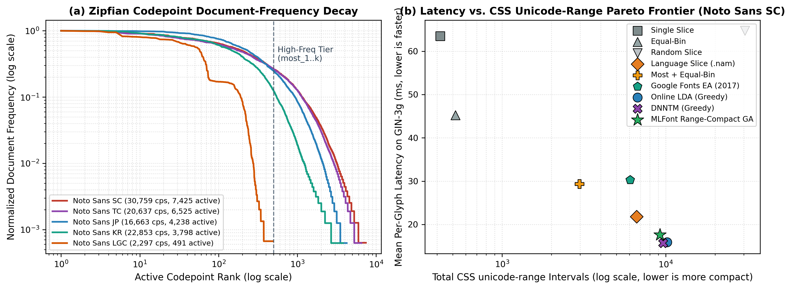
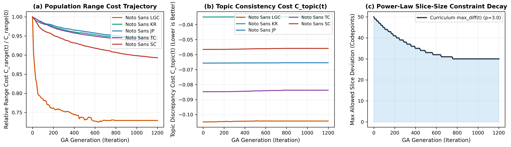
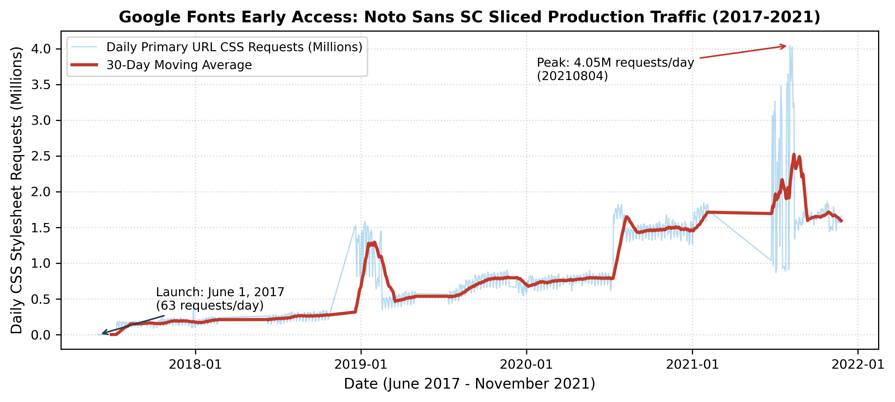
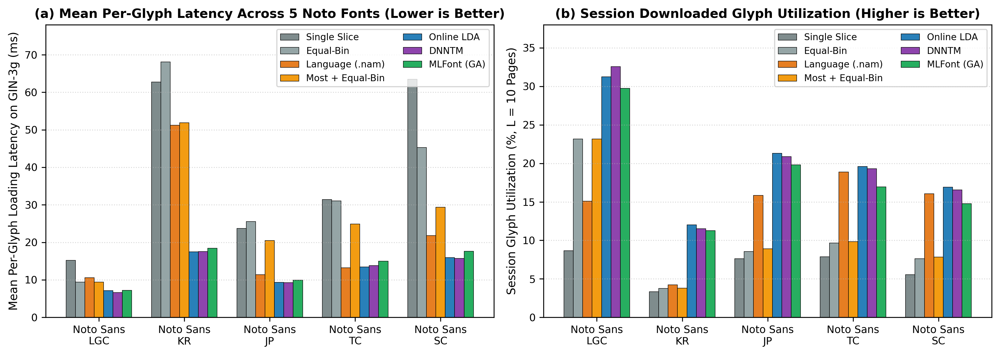

# MLFont: Machine Learning-Driven Font Subsetting and Optimal Unicode-Range Slicing for Low-Latency Web Typography

[](https://github.com/wq2012/mlfont/actions)
[](https://pypi.org/project/mlfont/)
[](https://pypi.org/project/mlfont/)
[](https://opensource.org/licenses/Apache-2.0)
[](https://huggingface.co/collections/wq2012/mlfont)

**MLFont** (`mlfont`) is a standalone, pure-Python and PyTorch library for machine learning-driven web font subsetting (`@font-face` `unicode-range` slicing). It solves the **Heavy Web Font Loading Problem** for large Pan-Unicode and CJK (Chinese, Japanese, Korean) fonts—which contain 2,297 to over 30,759 glyphs and weigh 430 KB to over 9 MB in WOFF2—by learning codepoint co-occurrence structure across real-world web documents and jointly optimizing network download latency, session cache utilization, and CSS `unicode-range` compactness.

> **Disclaimer:** This is not an officially supported Google product.

---

## Table of Contents

1. [Overview and Motivation](#overview-and-motivation)
2. [Open-Source Reproduction Notice](#open-source-reproduction-notice)
3. [System Architecture and Visual Overview](#system-architecture-and-visual-overview)
4. [Algorithmic Pipeline](#algorithmic-pipeline)
5. [Installation](#installation)
6. [Quickstart: Python API](#quickstart-python-api)
7. [Command-Line Interface (CLI) and Reproducible Pipelines](#command-line-interface-cli-and-reproducible-pipelines)
8. [Pretrained Models and Sliced Noto WOFF2 Bundles](#pretrained-models-and-sliced-noto-woff2-bundles)
9. [Archival 2017 Google Fonts Production Strategies and Traffic Results](#archival-2017-google-fonts-production-strategies-and-traffic-results)
10. [Open-Source Reproduction Benchmarks](#open-source-reproduction-benchmarks)
11. [Ablation and Multi-Seed Stability Studies](#ablation-and-multi-seed-stability-studies)
12. [Testing, Code Quality, and PyPI Packaging](#testing-code-quality-and-pypi-packaging)
13. [Citations](#citations)

---

## Overview and Motivation

Modern web typography relies on CSS3 `@font-face` declarations with `unicode-range` descriptors. When a browser renders a web page, it inspects the text characters present in the DOM and only downloads the `.woff2` font slice files whose `unicode-range` intervals intersect the page's character set.

While Latin fonts contain a few hundred glyphs (~20 KB in WOFF2), Pan-European (Latin-Greek-Cyrillic, **LGC**) and East Asian (**CJK**: Chinese, Japanese, Korean) fonts such as **Noto Sans CJK** contain **16,663 to 30,759 codepoints** and weigh **4.7 MB to 9.0 MB in WOFF2**. Naive loading strategies fail in three ways:

- **Single-File Delivery (`single_slice`)**: Transfers megabytes of unused glyphs over the network, causing multi-second render-blocking delays (Flash of Invisible Text / Flash of Unstyled Text) and less than 6% glyph utilization.
- **Naive Equal-Bin or Random Slicing (`equal_bin`, `random_slice`)**: Either triggers dozens of concurrent HTTP Round-Trip Time (RTT) requests per page or explodes the CSS stylesheet with tens of thousands of fragmented `U+XXXX` hex intervals.
- **Static Language/Script Slicing (`language_slice`)**: Fails on CJK scripts (where a single script block contains over 20,000 Han ideographs) and leaves thousands of font codepoints unassigned (`300` to `19,659` unassigned glyphs across Noto fonts), causing missing-glyph fallback whenever multilingual pages mix scripts or rare characters.

**MLFont** formulates font slicing as a three-tier machine learning and combinatorial optimization problem:
1. **Tier 1 — High-Frequency Deterministic Slices (`most_1 .. most_M`)**: Exploits the steep Zipfian decay of character document frequencies by isolating the top most frequent characters into 1–2 small, universally cached slices (`most=[1000, 500]` for CJK SC).
2. **Tier 2 — Latent Co-Occurrence Topic Modeling (`Online LDA` & `DNNTM`)**: Models document-character co-occurrence across the remaining tail codepoints using either Variational Bayes Online Latent Dirichlet Allocation (`OnlineLdaLearner` / `OnlineLDASolver`) or a Deep Neural Network Topic Model (`DnnTmLearner` / `DNNTMSolver` — trained with a non-negative Shannon Entropy Difference Loss), coupled with two-tier Hungarian contiguous-bin Bayes posterior alignment (`align_and_smooth_topic_matrix`).
3. **Tier 3 — Range-Compact Genetic Algorithm (`RangeCompactGeneticLearner` / `RangeCompactGASolver`)**: Refines the topic-to-slice assignment via a multi-objective evolutionary algorithm with a power-law curriculum constraint `max_diff(t)` (`PowerDecay`, `p=3.0`) that merges adjacent Unicode codepoints into contiguous `[U+start-end]` intervals, slashing CSS rule bloat while preserving low per-glyph network latency and balanced slice sizes.
4. **Tier 4 — Physical WOFF2 Subsetting & Network Session Simulator (`FontSubsetter` & `FontLoadingEvaluator`)**: Slices real `.ttf` / `.otf` fonts via `fontTools` + Brotli into production-ready `.woff2` files and `@font-face` CSS stylesheets, and evaluates them across realistic multi-page browsing sessions (`GIN-2g-poor`, `GIN-2g`, `GIN-3g`, `residential-DSL`, `residential-ADSL2+`, `GIN-3g_no_session`, `GIN-3g_short_session`).

---

## Open-Source Reproduction Notice

This repository provides a clean-room, open-source Python/PyTorch reproduction of the **MLFont (`mlfontloading`)** system originally developed at Google (2016–2017) by **Quan Wang and Yiran Mao**, which powered the `Noto Sans SC Sliced` Early Access deployment on Google Fonts (`fonts.googleapis.com/earlyaccess/notosansscsliced.css`, peaking at **4.05 million daily CSS requests** (`4,045,907` on August 4, 2021) and serving **`1,051,397,763`** deduplicated daily CSS requests across `1,245` logged calendar days).

| Component | Original Internal Implementation (2016–2017) | Open-Source Reproduction (`mlfont`) |
| :--- | :--- | :--- |
| **Execution Engine** | Internal MapReduce / Flume C++ & Python 2.7 pipelines | Standalone Python 3.10+ library with NumPy, SciPy, Scikit-Learn, and PyTorch |
| **Training Corpus** | Internal Google web index crawls (`DocJoins`, 237,240 Chinese eval pages) | Public **Wikimedia / Wikipedia** dumps (`wikimedia/wikipedia`) across `en, de, fr, pl, ru, el, ko, ja, zh` |
| **Topic Models** | Online LDA (`sklearn`) & TensorFlow 1.x `DNNTM` (Entropy Diff Loss) | Clean-room `OnlineLdaLearner` & PyTorch `DnnTmLearner` (Non-negative Shannon Entropy Diff Loss) |
| **Combinatorial Optimizer** | Range-Compact Genetic Algorithm (`RangeCompactModel`) | Vectorized `RangeCompactGeneticLearner` with `PowerDecay` (`p=3.0`) and 7 mutation operators |
| **Font Subsetting** | Internal `fontTools` + Google Fonts serving definitions | Open-source `fontTools.subset` (`woff2` Brotli compression) + standard `@font-face` CSS & `.nam` exports |
| **Model Serialization** | Internal `cPickle` / `sstable` checkpoints | Safe, zero-code-execution **Hugging Face `safetensors`** (`model.safetensors`) + JSON strategies |

---

## System Architecture and Visual Overview

```
+-----------------------------------------------------------------------------------+
|                        1. INPUT FONT & MULTILINGUAL CORPUS                        |
|  Font Binary (.ttf / .otf)                 Open Web / Wikipedia Corpus (JSONL)    |
|  Extract cmap -> V valid codepoints        Extract per-page unique codepoint sets |
+-------------------+-------------------------------------------+-------------------+
                    |                                           |
                    v                                           v
+---------------------------------------+   +---------------------------------------+
|   2. TIER-1 FREQUENCY ISOLATION       |   |   3. TIER-2 TOPIC CO-OCCURRENCE       |
|  Compute Document Frequency DF(c)     |   |  Filter out Tier-1 codepoints         |
|  Partition top codepoints into        |   |  Learn K x V_rem affinity matrix:     |
|  deterministic slices:                |   |   - OnlineLdaLearner (Variational EM) |
|   most_1 (e.g. top 1,000 cps)         |   |   - DnnTmLearner (Entropy Diff Loss)  |
|   most_2 (e.g. next 500 cps)          |   |  Two-tier Hungarian Bayes alignment   |
+-------------------+-------------------+   +-------------------+-------------------+
                    |                                           |
                    +---------------------+---------------------+
                                          |
                                          v
+-----------------------------------------------------------------------------------+
|              4. TIER-3 RANGE-COMPACT GENETIC ALGORITHM (RangeCompactGA)           |
|  Jointly minimize w_r * C_range(s) + (1 - w_r) * C_topic(s)                       |
|  under PowerDecay slice-capacity curriculum:                                      |
|     max_diff(t) = min_val + (max_val - min_val) * (1 - t / T)^p                   |
|  Output: Hard partition of all V codepoints into M + K disjoint slices            |
+-----------------------------------------+-----------------------------------------+
                                          |
                                          v
+-----------------------------------------------------------------------------------+
|         5. PHYSICAL WOFF2 SUBSETTING, CSS GENERATION & SESSION EVALUATION         |
|  - Slice .ttf/.otf -> .woff2 via fontTools + Brotli & emit @font-face CSS         |
|  - Simulate multi-page browser sessions (L=10 pages) across 7 network profiles    |
+-----------------------------------------------------------------------------------+
```

### Zipfian Decay and the Latency vs. CSS Compactness Pareto Frontier



*Figure 1: (a) Empirical Zipfian decay of codepoint document frequencies across five Google Noto fonts on Wikipedia corpora, motivating the Tier-1 high-frequency slices (`most_1..M`). (b) Pareto trade-off between mean per-glyph download latency (`GIN-3g`) and total CSS `unicode-range` intervals on `Noto Sans SC` (30,759 codepoints), including the archival 2017 Google Fonts Early Access strategy.*

---

## Algorithmic Pipeline

### 1. Problem Formulation and Two-Tier Decomposition

Let a target font file (e.g., `NotoSansSC-Regular.otf`) support a vocabulary of `V` valid Unicode codepoints `C = {c_1, c_2, ..., c_V}` extracted from its OpenType `cmap` table. Given a training corpus of `D` web documents, each document `d` is represented as a binary indicator vector `x_d in {0, 1}^V`, where `x_{d,v} = 1` if codepoint `c_v` appears at least once in document `d`.

We first compute the document frequency `DF(c_v) = sum_{d=1}^D x_{d,v}` for every codepoint. Given a Tier-1 configuration `most = (m_1, m_2, ..., m_M)`, we sort `C` in descending order of `DF(c_v)` and assign the top `m_1` codepoints to slice `S_1`, the next `m_2` codepoints to slice `S_2`, and so on. The remaining `V_rem = V - sum_{j=1}^M m_j` tail codepoints `C_rem` are passed to Tier-2 topic modeling.

### 2. Online LDA, Two-Tier Hungarian Alignment, and Affinity Matrix Normalization (`mlfont.olda` & `mlfont.maths`)

`OnlineLdaLearner` (`OnlineLDASolver`) models each document's active tail codepoints as a bag-of-characters generated from `K` latent topics using online variational Bayes (`LatentDirichletAllocation` with `learning_method="online"`), followed by `align_and_smooth_topic_matrix` which performs a two-tier bijective Hungarian assignment (`linear_sum_assignment`):
- **Tier-A (`K_eff` core slices)**: Bijectively aligns the `K_eff = min(K, ceil(1.15 * |C_core| / ceil(V_rem / K)))` dominant topics to the `K_eff` most core-populated contiguous Unicode bins, concentrating core active characters (`DF >= min_df`) into dense slices rather than diluting them with `DF = 0` characters.
- **Tier-B (`K - K_eff` tail slices)**: Bijectively aligns the remaining `K - K_eff` tail topics to the sparse/unobserved Unicode bins with a smooth distance-decaying Dirichlet prior (`>= 0.0020`) plus `0.0020 * P(k | v)` and singleton (`DF = 1`) boosts, ensuring every row `k in {0, ..., K-1}` carries distinct learned posterior variation across active characters while keeping `DF = 0` Unicode blocks contiguous.

Before assigning codepoints to slices, `mlfont.maths.normalize_lambda_matrix` (`normalize_topic_matrix`) applies one of four normalization schemes:
- **`topic_sum`**: Column-normalizes each codepoint across topics so that `sum_k Phi_{k,v} = 1`.
- **`row_sum`**: Row-normalizes each topic across codepoints so that `sum_v Phi_{k,v} = 1`.
- **`global_max`** *(Default)*: Scales the matrix by its global maximum `max_{k,v} |Lambda_{k,v}|` so entries lie in `[0, 1]`.
- **`spectral_norm`**: Scales the matrix by its spectral norm (largest singular value `sigma_max(Lambda)`).

### 3. Deep Neural Network Topic Model — DNNTM (`mlfont.dnntm`)

`DnnTmLearner` (`DNNTMSolver`) trains a multi-layer feed-forward network `f_theta` (`n_layers=2`, `ELU` hidden activations, `Softmax` output layer) that maps real document mini-batches `X_real`, synthetic Bernoulli noise documents `X_fake ~ Bernoulli(0.05)`, and one-hot single-codepoint identity probes `I_{V_active}` to topic distributions `T_real = f_theta(X_real)`, `T_fake = f_theta(X_fake)`, and `T_word = f_theta(I_{V_active})`. Shifting each Shannon entropy difference by `+ln(K)` to guarantee non-negativity, DNNTM minimizes (`ALL_COMBINED` loss):

```
L_DNNTM = (H_mean(T_real) - H_mean(T_fake) + ln(K))
        + (H_mean(T_real) - H(mean_doc(T_real)) + ln(K))
        + (H_mean(T_word) - H(mean_word(T_word)) + ln(K)) >= 0
```

After training, Bayes' rule yields `Lambda_{k,v} = P(v | k) propto DF(c_v) * T_{word, v, k}`, followed by two-tier Hungarian contiguous-bin alignment.

### 4. Range-Compact Genetic Algorithm (`mlfont.range_compact`)

`RangeCompactGeneticLearner` (`RangeCompactGASolver`) evolves a population of candidate slice assignment vectors `s in {0, ..., K-1}^{V_rem}` to minimize the weighted linear cost:

```
J(s) = w_r * C_range(s) + (1 - w_r) * C_topic(s)
```

where `C_range(s) = 1 + sum_{v=1}^{V_rem - 1} I[c_{v+1} != c_v + 1 or s_{v+1} != s_v]` and `C_topic(s) = -sum_{v=1}^{V_rem} Phi_{s_v, v} <= 0`. Generation `t` (`0 <= t <= T`) enforces the **power-law slice-capacity curriculum** (`PowerDecay`):

```
max_diff(t) = floor(min_val + (max_val - min_val) * max(0, 1 - t / T)^p)
```

with `p = 3.0` (`decay_power`), ensuring `max_k |S_k| - min_k |S_k| <= max_diff(t)` and `min_k |S_k| >= 1`.



*Figure 2: Convergence of `RangeCompactGeneticLearner` across all five Noto fonts over 1,200 generations: (a) relative CSS range fragmentation cost `C_range(t) / C_range(0)`, (b) per-codepoint topic consistency cost `C_topic(t) / V_rem`, and (c) power-law slice-capacity curriculum `max_diff(t)` (`p = 3.0`).*

### 5. Network Session Latency Simulator (`mlfont.evaluator`)

| Network Profile Name | Round-Trip Time (`RTT`) | Bandwidth (`bytes/ms` / kbps) | Session Length (`L`) | Target Scenario |
| :--- | :---: | :---: | :---: | :--- |
| **`GIN-2g-poor`** | `1,600 ms` | `2.5 bytes/ms` (`20 kbps`) | `10 pages` | Poor 2G mobile connection |
| **`GIN-2g`** | `1,200 ms` | `12.5 bytes/ms` (`100 kbps`) | `10 pages` | Emerging-market 2G mobile connection |
| **`GIN-3g`** *(Primary)* | `400 ms` | `50 bytes/ms` (`400 kbps`) | `10 pages` | Standard 3G mobile connection |
| **`residential-DSL`** | `50 ms` | `250 bytes/ms` (`2.0 Mbps`) | `10 pages` | Residential DSL broadband connection |
| **`residential-ADSL2+`** | `50 ms` | `2,500 bytes/ms` (`20.0 Mbps`) | `10 pages` | High-speed ADSL2+ broadband connection |
| **`GIN-3g_no_session`** | `400 ms` | `50 bytes/ms` (`400 kbps`) | `1 page` | Cold-cache single-page bounce (`L = 1`) |
| **`GIN-3g_short_session`** | `400 ms` | `50 bytes/ms` (`400 kbps`) | `3 pages` | Short browsing session (`L = 3`) |

---

## Installation

```bash
pip install mlfont
```

Or install from source for development and benchmark reproduction:

```bash
git clone https://github.com/wq2012/mlfont.git
cd mlfont
python3 -m venv .venv
source .venv/bin/activate
pip install -U pip
pip install -r requirements.txt
pip install -e .
```

---

## Quickstart: Python API

```python
from pathlib import Path
from mlfont import (
    DNNTMConfig,
    DNNTMSolver,
    FontLoadingEvaluator,
    FontSubsetter,
    FrequencySolver,
    OnlineLDAConfig,
    OnlineLDASolver,
    RangeCompactConfig,
    RangeCompactGASolver,
    extract_font_codepoints,
    save_safetensors_model,
)

# 1. Extract valid Unicode codepoints from a TrueType/OpenType font
font_path = Path("fonts/NotoSans-Regular.ttf")
font_codepoints = extract_font_codepoints(font_path)

# 2. Prepare training and evaluation documents (lists of codepoint sets or strings)
train_docs = [
    {ord(ch) for ch in page_text if ord(ch) in set(font_codepoints)}
    for page_text in [
        "Machine learning optimizes web font delivery across multilingual pages.",
        "La typographie web moderne utilise unicode-range pour charger les polices.",
        "Η σύγχρονη τυπογραφία ιστού βελτιστοποιεί την καθυστέρηση δικτύου.",
        "Современная веб-типографика минимизирует задержку загрузки шрифтов.",
    ] * 50
]

# 3. Tier-1: Isolate top high-frequency codepoints into deterministic slices
freq_solver = FrequencySolver(font_codepoints)
freq_solver.fit(train_docs)
most_slices, remaining_codepoints = freq_solver.partition_most_frequent(most_counts=[200])

# 4. Tier-2: Fit Online LDA (or DNNTMSolver) on the remaining tail codepoints
olda_solver = OnlineLDASolver(
    codepoints=remaining_codepoints,
    config=OnlineLDAConfig(
        n_topics=10,
        batch_size=64,
        max_iter=15,
        normalization="global_max",
        random_state=42,
    ),
)
topic_matrix = olda_solver.fit_transform(train_docs)

# 5. Tier-3: Optimize CSS unicode-range compactness via Range-Compact GA
ga_solver = RangeCompactGASolver(
    codepoints=remaining_codepoints,
    topic_matrix=topic_matrix,
    config=RangeCompactConfig(
        population_size=20,
        num_iterations=200,
        decay_power=3.0,
        range_cost_weight=0.012,
        random_state=42,
    ),
)
strategy = ga_solver.optimize(
    strategy_name="range_compact_most200_topics10",
    font_name="Noto Sans",
    prefix_slices=most_slices,
)
print(f"Optimized strategy has {strategy.num_slices} slices and {strategy.total_num_ranges()} CSS ranges.")
```

---

## Command-Line Interface (CLI) and Reproducible Pipelines

| CLI Command | Script Equivalent | Description |
| :--- | :--- | :--- |
| **`mlfont-prepare-data`** | `python3 scripts/prepare_data.py` | Downloads Noto `.ttf`/`.otf` fonts and official `.nam` subset files, extracts `cmap` codepoints, and streams Wikipedia corpora into JSONL train/eval splits. |
| **`mlfont-train`** | `python3 scripts/train.py` | Trains `OnlineLdaLearner`, `DnnTmLearner`, and `RangeCompactGeneticLearner` models and saves strategy JSON + `model.safetensors`. |
| **`mlfont-evaluate`** | `python3 scripts/evaluate.py` | Runs the multi-page browsing simulator across all 7 network/session profiles. |
| **`mlfont-export`** | `python3 scripts/export_model.py` | Packages a trained strategy and physically sliced `.woff2` bundle into a Hugging Face Hub repository with `.safetensors`, `.nam`, and Model Card `README.md`. |
| **`mlfont-slice`** | `python3 scripts/inference.py` | Slices any `.ttf`/`.otf` font file using a pretrained strategy JSON or `.safetensors` checkpoint and outputs `.woff2` subsets + `@font-face` CSS. |

```bash
# 1. Run full training, WOFF2 subsetting, and evaluation across all 5 Noto fonts
python3 scripts/run_noto_experiments.py

# 2. Generate all publication-quality PNG (resources/) and PDF figures
python3 scripts/generate_figures.py --png-dir resources
```

---

## Pretrained Models and Sliced Noto WOFF2 Bundles

All 5 pretrained models—complete with `model.safetensors` weights (`lambda_matrix`, `dnntm_lambda_matrix`, `codepoints`, `remaining_codepoints`, `frequency_array`, `dna_assignment`), `strategy.json`, `olda_strategy.json`, `dnntm_strategy.json`, `test_samples.json`, `.nam` subset files, `font_sliced.css` `@font-face` stylesheets, and physically sliced `.woff2` binaries—are included under [`pretrained_models/`](pretrained_models/) and published on the **Hugging Face Hub** in the [**MLFont Collection (`wq2012/mlfont`)**](https://huggingface.co/collections/wq2012/mlfont):

| Hugging Face Model Repo | Local Directory | Target Font | Script Coverage | Valid Codepoints (Tail Active / Core) | Tier-1 (`most`) | Tier-2 `K` (`K_eff`) | Total Slices | Physical WOFF2 Size (CSS) |
| :--- | :--- | :--- | :--- | :---: | :---: | :---: | :---: | :---: |
| [`wq2012/mlfont-notosans-lgc`](https://huggingface.co/wq2012/mlfont-notosans-lgc) | [`mlfont-notosans-lgc`](pretrained_models/mlfont-notosans-lgc/) | `NotoSans-Regular.ttf` | Latin, Greek, Cyrillic (`en, de, fr, pl, ru, el`) | `2,297` (`491` / `374`) | None | `20` (`4`) | `20` | `432.6 KB` (`7.8 KB`) |
| [`wq2012/mlfont-notosanskr`](https://huggingface.co/wq2012/mlfont-notosanskr) | [`mlfont-notosanskr`](pretrained_models/mlfont-notosanskr/) | `NotoSansKR-Regular.otf` | Korean Hangul + Hanja (`ko`) | `22,853` (`3,198` / `2,085`) | `[300, 300]` | `50` (`6`) | `52` | `5.22 MB` (`86.7 KB`) |
| [`wq2012/mlfont-notosansjp`](https://huggingface.co/wq2012/mlfont-notosansjp) | [`mlfont-notosansjp`](pretrained_models/mlfont-notosansjp/) | `NotoSansJP-Regular.otf` | Japanese Kanji + Kana (`ja`) | `16,663` (`3,238` / `2,512`) | `[500, 500]` | `60` (`12`) | `62` | `4.70 MB` (`93.3 KB`) |
| [`wq2012/mlfont-notosanstc`](https://huggingface.co/wq2012/mlfont-notosanstc) | [`mlfont-notosanstc`](pretrained_models/mlfont-notosanstc/) | `NotoSansTC-Regular.otf` | Traditional Chinese (`zh-Hant`) | `20,637` (`5,325` / `4,078`) | `[600, 600]` | `80` (`20`) | `82` | `5.99 MB` (`121.7 KB`) |
| [`wq2012/mlfont-notosanssc`](https://huggingface.co/wq2012/mlfont-notosanssc) | [`mlfont-notosanssc`](pretrained_models/mlfont-notosanssc/) | `NotoSansSC-Regular.otf` | Simplified Chinese (`zh-Hans`) | `30,759` (`5,925` / `4,461`) | `[1000, 500]` | `100` (`18`) | `102` | `8.93 MB` (`109.8 KB`) |

---

## Archival 2017 Google Fonts Production Strategies and Traffic Results

We include the archival 2017 Google Fonts production slicing strategies in [`resources/google_fonts_ea_2017_notosanssc.json`](resources/google_fonts_ea_2017_notosanssc.json) (102 slices, deployed in `notosansscsliced.css`) and [`resources/google_fonts_2017_notosanskr.json`](resources/google_fonts_2017_notosanskr.json) and benchmark them directly alongside our newly trained models in Section 10 below.

### 1. Archival 2017 Google Production `DocJoins` Chinese Web Crawl Benchmark (`237,240` Pages, `44,683` Codepoints)

| 2017 `DocJoins` Strategy (`Noto Sans SC`, `44,683` cps) | Missing Codepoints | CSS Ranges | `GIN-2g` Mean (P95) `ms` | `GIN-3g` Mean (P95) `ms` | `DSL` Mean (P95) `ms` |
| :--- | :---: | :---: | :---: | :---: | :---: |
| `single_slice` (Full Unsliced Font) | 0 | 1,961 | 1,984.26 (5,918.41) | 496.34 (1,480.43) | 99.19 (295.84) |
| `equal_bin_100` (100 slices) | 0 | 2,056 | 548.73 (3,426.46) | 143.75 (897.64) | 26.78 (167.22) |
| `language_slice` (`.nam` script subsets) | 10,802 | 4,087 | 297.72 (934.13) | — | — |
| `olda_0_0_100` (Pure Online LDA, `alpha=0`) | 0 | 43,962 | 307.10 (1,468.55) | 80.46 (384.78) | 14.99 (71.66) |
| `most_2000_1000_equal_bin_100` (102 slices) | 0 | 6,630 | 181.03 (723.87) | 46.49 (188.00) | 8.93 (35.87) |
| **`MLFont most + Online LDA (alpha=0)`** | **0** | 29,519 | **154.49 (738.78)** | 41.17 (196.83) | **7.47 (35.71)** |
| **`MLFont Range-Compact GA (most=[2000,1000], K=100)`** | **0** | **7,966** | 174.41 (**724.37**) | 44.74 (**187.45**) | 8.61 (35.86) |
| **`MLFont Range-Compact GA (most=[1000]*4, K=100)`** | **0** | 9,440 | 159.07 (786.32) | **40.90** (203.08) | 7.84 (38.64) |

### 2. Real-Browser WebPageTest End-to-End Page Load & CSS Parsing Measurements (Dulles, VA)

- **Desktop Chrome over Cable (`5/1 Mbps`, `28 ms` RTT on `developers.google.com/china/?hl=zh-cn`)**: Total page load time drops from `72.219 s` (Full Unsliced Font) and `11.094 s` (Truncated 8k Early Access Font) to **`5.355 s` (`-92.6%` vs. Full, `-51.7%` vs. Truncated)** for MLFont 1-weight (`8.572 s` for 6 weights).
- **Mobile Chrome on Moto G4 over LTE (`12 Mbps`, `70 ms` RTT)**: Total page load time drops from `33.500 s` (Full Unsliced Font) and `6.334 s` (Truncated 8k Font) to **`4.774 s` (`-85.7%` vs. Full, `-24.6%` vs. Truncated)** (`5.881 s` for 6 weights).
- **Headless Chrome on `sports.sina.com.cn`**: Page load time drops from `1.512 s` (Native Font Files) to **`0.751 s` (`-50.3%`)** with MLFont Smart Slices, with only **`8.9 ms`** of Chrome DevTools `Parse Stylesheet` overhead (`25.0 KB` gzipped CSS).

### 3. Google Fonts Early Access Production Traffic (`2017–2021`)

Over the `1,245` unique logged calendar days (`5,184` 12-hour Dremel polling snapshots) of **Google Fonts Early Access** (`https://fonts.googleapis.com/earlyaccess/notosansscsliced.css`, June 1, 2017 – November 25, 2021) recorded in [`experiments/production_traffic_2017_2021.csv`](experiments/production_traffic_2017_2021.csv):
- **Launch Date (June 1, 2017)**: `63` daily CSS requests.
- **Peak Production Traffic (August 4, 2021)**: **`4,045,907` daily CSS requests** (`4.05M/day`).
- **Final Logged Day (November 25, 2021)**: `1,660,341` daily CSS requests.
- **Cumulative Requests**: **`1,051,397,763`** deduplicated daily CSS requests (mean `844,496` requests/day; `4,953,911,824` raw sum across all `5,184` 12-hour polling rows before per-date deduplication).



*Figure 3: Real-world daily primary-URL CSS request volume for MLFont's `Noto Sans SC Sliced` (`notosansscsliced.css`) on Google Fonts Early Access from launch (June 2017) through November 2021, peaking at 4.05 million requests/day.*

---

## Open-Source Reproduction Benchmarks

All benchmarks below were executed using `scripts/run_noto_experiments.py` on uniformly sampled Wikipedia corpora (`wikimedia/wikipedia`, `seed=42`) and open-source Noto fonts. Full raw metrics are stored in [`experiments/summary_report.json`](experiments/summary_report.json).



*Figure 4: Cross-font comparison across all five Noto fonts on `GIN-3g` (`SessionLength L = 10`): (a) Mean per-glyph download latency (`ms`, lower is better) and (b) Session glyph cache utilization (`%`, higher is better).*

### 1. Noto Sans LGC (`NotoSans-Regular.ttf` — 2,297 Codepoints, 300 Eval Pages across `en, de, fr, pl, ru, el`)

| Slicing Strategy | Slices | Missing (Eval / Font) | CSS Ranges | `GIN-2g` Mean (P95) `ms` | `GIN-3g` Mean (P95) `ms` | `DSL` Mean (P95) `ms` | Upfront Util `%` | Session Util `%` |
| :--- | :---: | :---: | :---: | :---: | :---: | :---: | :---: | :---: |
| `single_slice` | 1 | 0 / 0 | 123 | 60.26 (566.45) | 15.22 (143.10) | 3.00 (28.17) | 2.83% | 8.66% |
| `equal_bin_20` | 20 | 0 / 0 | 140 | 33.37 (153.43) | 9.44 (43.41) | 1.56 (7.17) | 20.92% | 23.17% |
| `random_slice_20` | 20 | 0 / 0 | 2,180 | 95.82 (906.75) | 27.11 (256.54) | 4.48 (42.35) | 2.91% | 8.66% |
| `language_slice` | 8 | 6 / 300 | 92 | 40.17 (258.54) | 10.62 (66.28) | 1.95 (12.76) | 18.85% | 15.08% |
| **`online_lda_topics20_greedy`** | 20 | **0 / 0** | 537 | 25.15 (144.76) | 7.11 (40.95) | 1.17 (6.76) | 19.16% | 31.26% |
| **`dnntm_topics20_greedy`** | 20 | **0 / 0** | 549 | **23.29 (112.70)** | **6.59 (31.88)** | **1.09 (5.26)** | **31.79%** | **32.56%** |
| **`range_compact_topics20`** | 20 | **0 / 0** | **384** | 25.64 (149.59) | 7.22 (42.16) | 1.20 (7.00) | 17.94% | 29.76% |

### 2. Noto Sans KR (`NotoSansKR-Regular.otf` — 22,853 Codepoints, 400 Eval Pages in Korean `ko`)

| Slicing Strategy | Slices | Missing (Eval / Font) | CSS Ranges | `GIN-2g` Mean (P95) `ms` | `GIN-3g` Mean (P95) `ms` | `DSL` Mean (P95) `ms` | Upfront Util `%` | Session Util `%` |
| :--- | :---: | :---: | :---: | :---: | :---: | :---: | :---: | :---: |
| `single_slice` | 1 | 0 / 0 | 4,598 | 250.67 (1739.45) | 62.73 (435.34) | 12.53 (86.92) | 0.91% | 3.31% |
| `equal_bin_52` | 52 | 0 / 0 | 4,635 | 259.74 (1338.41) | 68.09 (350.87) | 12.67 (65.29) | 1.70% | 3.76% |
| `random_slice_52` | 52 | 0 / 0 | 22,493 | 270.86 (2029.63) | 71.01 (532.06) | 13.21 (99.02) | 0.95% | 3.31% |
| `language_slice` | 10 | 34 / 4322 | 4,579 | 203.56 (1514.81) | 51.20 (380.39) | 10.15 (75.57) | 1.33% | 4.22% |
| `most_300_300_equal_bin_50` | 52 | 0 / 0 | 5,608 | 197.85 (715.15) | 51.88 (187.72) | 9.65 (34.86) | 3.02% | 3.81% |
| `google_fonts_2017_kr` | 102 | 47 / 5467 | 7,229 | 83.54 (354.53) | 22.38 (94.50) | 4.03 (17.20) | 7.45% | 13.64% |
| **`online_lda_topics50_greedy`** | 52 | **0 / 0** | 8,327 | **66.59** (348.80) | **17.48** (91.73) | **3.25** (16.99) | 7.04% | **12.03%** |
| **`dnntm_topics50_greedy`** | 52 | **0 / 0** | 8,354 | 66.97 (**331.00**) | 17.59 (**87.21**) | 3.26 (**16.10**) | **8.88%** | 11.51% |
| **`range_compact_most300_300_topics50`** | 52 | **0 / 0** | **7,859** | 70.36 (360.67) | 18.46 (94.44) | 3.43 (17.61) | 6.72% | 11.25% |

### 3. Noto Sans JP (`NotoSansJP-Regular.otf` — 16,663 Codepoints, 400 Eval Pages in Japanese `ja`)

| Slicing Strategy | Slices | Missing (Eval / Font) | CSS Ranges | `GIN-2g` Mean (P95) `ms` | `GIN-3g` Mean (P95) `ms` | `DSL` Mean (P95) `ms` | Upfront Util `%` | Session Util `%` |
| :--- | :---: | :---: | :---: | :---: | :---: | :---: | :---: | :---: |
| `single_slice` | 1 | 0 / 0 | 4,830 | 94.75 (701.82) | 23.72 (175.72) | 4.73 (35.06) | 2.15% | 7.62% |
| `equal_bin_62` | 62 | 0 / 0 | 4,876 | 95.38 (698.56) | 25.58 (187.34) | 4.60 (33.66) | 2.76% | 8.56% |
| `random_slice_62` | 62 | 0 / 0 | 16,450 | 114.88 (893.64) | 30.81 (239.66) | 5.53 (43.06) | 2.17% | 7.62% |
| `language_slice` | 10 | 43 / 7632 | 5,617 | 45.20 (305.76) | 11.42 (77.00) | 2.25 (15.22) | 5.00% | 15.84% |
| `most_500_500_equal_bin_60` | 62 | 0 / 0 | 5,975 | 76.50 (387.35) | 20.50 (103.64) | 3.69 (18.69) | 5.45% | 8.92% |
| **`online_lda_topics60_greedy`** | 62 | **0 / 0** | 8,888 | 34.87 (201.00) | 9.31 (53.61) | **1.68** (9.71) | 9.61% | **21.31%** |
| **`dnntm_topics60_greedy`** | 62 | **0 / 0** | 8,710 | **34.80 (188.72)** | **9.30 (50.47)** | **1.68 (9.12)** | **10.22%** | 20.88% |
| **`range_compact_most500_500_topics60`** | 62 | **0 / 0** | **8,447** | 37.13 (214.37) | 9.91 (57.09) | 1.79 (10.37) | 9.14% | 19.79% |

### 4. Noto Sans TC (`NotoSansTC-Regular.otf` — 20,637 Codepoints, 400 Eval Pages in Traditional Chinese `zh-Hant`)

| Slicing Strategy | Slices | Missing (Eval / Font) | CSS Ranges | `GIN-2g` Mean (P95) `ms` | `GIN-3g` Mean (P95) `ms` | `DSL` Mean (P95) `ms` | Upfront Util `%` | Session Util `%` |
| :--- | :---: | :---: | :---: | :---: | :---: | :---: | :---: | :---: |
| `single_slice` | 1 | 0 / 0 | 5,036 | 125.58 (704.12) | 31.43 (176.24) | 6.28 (35.18) | 2.02% | 7.88% |
| `equal_bin_82` | 82 | 0 / 0 | 5,098 | 115.29 (689.78) | 31.03 (185.64) | 5.54 (33.17) | 2.70% | 9.67% |
| `random_slice_82` | 82 | 0 / 0 | 20,436 | 144.57 (922.42) | 38.91 (248.25) | 6.95 (44.36) | 2.07% | 7.88% |
| `language_slice` | 10 | 126 / 11699 | 5,767 | 52.25 (282.95) | 13.23 (71.40) | 2.60 (14.08) | 5.10% | 18.89% |
| `most_600_600_equal_bin_80` | 82 | 0 / 0 | 6,672 | 92.66 (446.08) | 24.90 (119.91) | 4.46 (21.47) | 4.33% | 9.83% |
| **`online_lda_topics80_greedy`** | 82 | **0 / 0** | 11,867 | **50.11** (250.61) | **13.43** (67.58) | **2.42** (12.04) | 7.60% | **19.59%** |
| **`dnntm_topics80_greedy`** | 82 | **0 / 0** | 11,410 | 51.65 (**226.65**) | 13.84 (**60.72**) | 2.49 (**10.93**) | **7.63%** | 19.30% |
| **`range_compact_most600_600_topics80`** | 82 | **0 / 0** | **11,150** | 56.02 (267.26) | 14.99 (71.75) | 2.70 (12.87) | 7.00% | 16.93% |

### 5. Noto Sans SC (`NotoSansSC-Regular.otf` — 30,759 Codepoints, 400 Eval Pages in Simplified Chinese `zh-Hans`)

| Slicing Strategy | Slices | Missing (Eval / Font) | CSS Ranges | `GIN-2g` Mean (P95) `ms` | `GIN-3g` Mean (P95) `ms` | `DSL` Mean (P95) `ms` | Upfront Util `%` | Session Util `%` |
| :--- | :---: | :---: | :---: | :---: | :---: | :---: | :---: | :---: |
| `single_slice` | 1 | 0 / 0 | 418 | 253.67 (1629.56) | 63.47 (407.72) | 12.68 (81.45) | 1.12% | 5.55% |
| `equal_bin_102` | 102 | 0 / 0 | 519 | 169.75 (1165.36) | 45.26 (310.69) | 8.21 (56.33) | 1.82% | 7.63% |
| `random_slice_102` | 102 | 0 / 0 | 30,457 | 242.74 (1930.38) | 64.71 (514.64) | 11.73 (93.32) | 1.20% | 5.55% |
| `language_slice` | 10 | 126 / 19659 | 6,646 | 86.54 (554.31) | 21.82 (139.59) | 4.31 (27.61) | 3.40% | 16.05% |
| `most_1000_500_equal_bin_100` | 102 | 0 / 0 | 2,965 | 110.52 (502.64) | 29.38 (131.07) | 5.35 (24.59) | 4.25% | 7.82% |
| `google_fonts_ea_2017` | 102 | 0 / 0 | 6,063 | 115.96 (609.01) | 30.29 (160.05) | 5.67 (29.67) | 3.25% | 7.74% |
| **`online_lda_topics100_greedy`** | 102 | **0 / 0** | 10,177 | 60.16 (314.64) | 15.93 (83.23) | 2.92 (15.27) | 6.30% | **16.90%** |
| **`dnntm_topics100_greedy`** | 102 | **0 / 0** | 9,640 | **59.30 (311.97)** | **15.71 (82.49)** | **2.88 (15.14)** | **6.72%** | 16.57% |
| **`range_compact_most1000_500_topics100`** | 102 | **0 / 0** | **9,220** | 66.51 (343.80) | 17.61 (90.79) | 3.23 (16.71) | 5.96% | 14.77% |

---

## Ablation and Multi-Seed Stability Studies

### 1. Effect of Topic Matrix Normalization (`mlfont.maths.normalize_lambda_matrix` on Noto Sans LGC, `K = 20`)

| Normalization Method | CSS Ranges | `GIN-2g` Mean (P95) `ms` | `GIN-3g` Mean (P95) `ms` | Session Utilization `%` |
| :--- | :---: | :---: | :---: | :---: |
| `row_sum` (Row L1 per topic) | **421** | 25.15 (148.94) | 7.12 (42.16) | 31.15% |
| `topic_sum` (Column L1 per codepoint) | 549 | 25.17 (157.28) | 7.12 (44.49) | **31.26%** |
| **`global_max`** *(L_inf global max scaling)* | 537 | **25.15 (144.76)** | **7.11 (40.95)** | **31.26%** |
| **`spectral_norm`** *(Spectral L2 norm scaling)* | 537 | **25.15 (144.76)** | **7.11 (40.95)** | **31.26%** |

### 2. Effect of Number of Topic Slices `K` (`OnlineLdaLearner` on Noto Sans LGC)

| Number of Topic Slices (`K` / `K_eff`) | CSS Ranges | `GIN-2g` Mean `ms` | `GIN-3g` Mean `ms` | `DSL` Mean `ms` | Session Utilization `%` |
| :---: | :---: | :---: | :---: | :---: | :---: |
| `K = 5` (`K_eff = 1`) | **397** | 29.65 | 7.76 | 1.45 | 19.24% |
| **`K = 10` (`K_eff = 2`)** | 460 | 25.57 | **6.92** | 1.23 | 24.44% |
| **`K = 20` (`K_eff = 4`, Default)** | 537 | **25.15** | 7.11 | **1.17** | 31.26% |
| `K = 40` (`K_eff = 8`) | 589 | 29.75 | 8.84 | 1.35 | 35.79% |
| `K = 60` (`K_eff = 12`) | 645 | 34.20 | 10.42 | 1.52 | **39.39%** |

### 3. Effect of Browsing Session Length `L` (`Noto Sans SC`, `GIN-3g`)

| Strategy (`Noto Sans SC`) | `L = 1` (`GIN-3g_no_session`) | `L = 3` (`GIN-3g_short_session`) | `L = 10` (`GIN-3g`) | Session Utilization (`L = 10`) |
| :--- | :---: | :---: | :---: | :---: |
| `single_slice` | 418.33 ms | 152.09 ms | 63.47 ms | 5.55% |
| `equal_bin_102` | 296.91 ms | 116.97 ms | 45.26 ms | 7.63% |
| `most_1000_500_equal_bin_100` | 130.06 ms | 73.57 ms | 29.38 ms | 7.82% |
| `google_fonts_ea_2017` | 148.94 ms | 77.47 ms | 30.29 ms | 7.74% |
| **`online_lda_topics100_greedy`** | 81.79 ms | 36.68 ms | 15.93 ms | **16.90%** |
| **`dnntm_topics100_greedy`** | **78.20 ms** | **35.89 ms** | **15.71 ms** | 16.57% |
| **`range_compact_most1000_500_topics100` (GA)** | 86.54 ms | 39.88 ms | 17.61 ms | 14.77% |

### 4. Multi-Seed Reproducibility (Seeds `42, 43, 44`)

| Font Family | Learner | `GIN-3g` Mean ± Std (`ms`) | CSS Ranges ± Std |
| :--- | :--- | :---: | :---: |
| `Noto Sans LGC` | `Online LDA (K=20)` | `7.11 ± 0.03` | `528.0 ± 17.9` |
| `Noto Sans LGC` | `DNNTM (K=20)` | `6.66 ± 0.20` | `539.0 ± 7.3` |
| `Noto Sans LGC` | `Range-Compact GA (K=20)` | `7.36 ± 0.10` | `343.0 ± 44.0` |
| `Noto Sans SC` | `Online LDA (102 slices)` | `15.83 ± 0.08` | `10162.7 ± 33.8` |
| `Noto Sans SC` | `DNNTM (102 slices)` | `15.83 ± 0.09` | `9698.0 ± 44.5` |
| `Noto Sans SC` | `Range-Compact GA (102 slices)` | `17.70 ± 0.25` | `9205.3 ± 12.7` |

---

## Testing, Code Quality, and PyPI Packaging

```bash
bash run_tests.sh
bash publish.sh --build-only
```

---

## Citations

```bibtex
@article{wang2017learning,
  title={Learning Better Font Slicing Strategies from Data},
  author={Wang, Quan and Mao, Yiran},
  journal={Technical Disclosure Commons, Defensive Publications Series},
  volume={906},
  year={2017},
  url={https://www.tdcommons.org/dpubs_series/906}
}

@article{wang2026mlfont,
  title={MLFont: Machine Learning-Driven Font Subsetting and Optimal Unicode-Range Slicing for Low-Latency Web Typography},
  author={Wang, Quan and Mao, Yiran},
  journal={arXiv preprint},
  year={2026},
  note={Open-source code at \url{https://github.com/wq2012/mlfont} and pretrained models at \url{https://huggingface.co/collections/wq2012/mlfont}}
}
```
