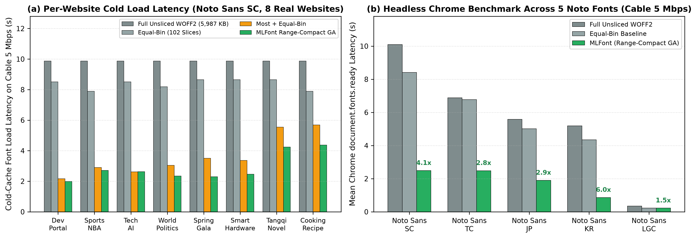

# MLFont: Machine Learning-Driven Font Subsetting and Optimal Unicode-Range Slicing for Low-Latency Web Typography

[](https://github.com/wq2012/mlfont/actions)
[](https://pypi.org/project/mlfont/)
[](https://pypi.org/project/mlfont/)
[](https://opensource.org/licenses/Apache-2.0)
[](https://huggingface.co/collections/wq2012/mlfont)

**MLFont** (`mlfont`) is a standalone, pure-Python and PyTorch library for machine learning-driven web font subsetting (`@font-face` `unicode-range` slicing). It solves the **Heavy Web Font Loading Problem** for large Pan-Unicode and CJK (Chinese, Japanese, Korean) fonts—which contain 2,297 to over 30,759 glyphs and weigh 430 KB to over 9 MB in WOFF2—by learning codepoint co-occurrence structure across real-world web documents and jointly optimizing network download latency, session cache utilization, and CSS `unicode-range` compactness.

---

## Table of Contents

1. [Overview and Motivation](#overview-and-motivation)
2. [Open-Source Reproduction Notice](#open-source-reproduction-notice)
3. [System Architecture and Visual Overview](#system-architecture-and-visual-overview)
4. [Algorithmic Pipeline](#algorithmic-pipeline)
5. [Using Sliced Web Fonts in Your Website (Frontend Developer Guide)](#using-sliced-web-fonts-in-your-website-frontend-developer-guide)
6. [Website Font Loading Simulation and Real Browser Benchmarking](#website-font-loading-simulation-and-real-browser-benchmarking)
7. [Installation (Python Library & CLI)](#installation-python-library--cli)
8. [Quickstart: Python API](#quickstart-python-api)
9. [Command-Line Interface (CLI) and Reproducible Pipelines](#command-line-interface-cli-and-reproducible-pipelines)
10. [Pretrained Models and Sliced Noto WOFF2 Bundles](#pretrained-models-and-sliced-noto-woff2-bundles)
11. [Open-Source Reproduction Benchmarks](#open-source-reproduction-benchmarks)
12. [Ablation and Multi-Seed Stability Studies](#ablation-and-multi-seed-stability-studies)
13. [Testing, Code Quality, and PyPI Packaging](#testing-code-quality-and-pypi-packaging)
14. [Citations](#citations)

---

## Overview and Motivation

Modern web typography relies on CSS3 `@font-face` declarations with `unicode-range` descriptors. When a browser renders a web page, it inspects the text characters present in the DOM and only downloads the `.woff2` font slice files whose `unicode-range` intervals intersect the page's character set.

While Latin fonts contain a few hundred glyphs (~20 KB in WOFF2), Pan-European (Latin-Greek-Cyrillic, **LGC**) and East Asian (**CJK**: Chinese, Japanese, Korean) fonts such as **Noto Sans CJK** contain **16,663 to 30,759 codepoints** and weigh **4.7 MB to 9.0 MB in WOFF2**. Naive loading strategies fail in three ways:

- **Single-File Delivery (`single_slice`)**: Transfers megabytes of unused glyphs over the network, causing multi-second render-blocking delays (Flash of Invisible Text / Flash of Unstyled Text) and less than 6% glyph utilization.
- **Naive Equal-Bin or Random Slicing (`equal_bin`, `random_slice`)**: Either triggers dozens of concurrent HTTP Round-Trip Time (RTT) requests per page or explodes the CSS stylesheet with tens of thousands of fragmented `U+XXXX` hex intervals.
- **Static Language/Script Slicing (`language_slice`)**: Fails on CJK scripts (where a single script block contains over 20,000 Han ideographs) and leaves thousands of font codepoints unassigned (`300` to `19,659` unassigned glyphs across Noto fonts), causing missing-glyph fallback whenever multilingual pages mix scripts or rare characters.

**MLFont** formulates font slicing as a three-tier machine learning and combinatorial optimization problem:
1. **Tier 1 — High-Frequency Deterministic Slices (`most_1 .. most_M`)**: Exploits the steep Zipfian decay of character document frequencies by isolating the top most frequent characters into 1–2 small, universally cached slices (`most=[1000, 500]` for CJK SC).
2. **Tier 2 — Latent Co-Occurrence Topic Modeling (`Online LDA` & `DNNTM`)**: Models document-character co-occurrence across the remaining tail codepoints using either Variational Bayes Online Latent Dirichlet Allocation (`OnlineLdaLearner` / `OnlineLDASolver`) or a Deep Neural Network Topic Model (`DnnTmLearner` / `DNNTMSolver` — trained with a non-negative Shannon Entropy Difference Loss), coupled with two-tier Hungarian contiguous-bin Bayes posterior alignment (`align_and_smooth_topic_matrix`).
3. **Tier 3 — Range-Compact Genetic Algorithm (`RangeCompactGeneticLearner` / `RangeCompactGASolver`)**: Refines the topic-to-slice assignment via a multi-objective evolutionary algorithm with a power-law curriculum constraint `max_diff(t)` (`PowerDecay`, `p=3.0`) that merges adjacent Unicode codepoints into contiguous `[U+start-end]` intervals, slashing CSS rule bloat while preserving low per-glyph network latency and balanced slice sizes.
4. **Tier 4 — Physical WOFF2 Subsetting & Network Session Simulator (`FontSubsetter` & `FontLoadingEvaluator`)**: Slices real `.ttf` / `.otf` fonts via `fontTools` + Brotli into production-ready `.woff2` files and `@font-face` CSS stylesheets, and evaluates them across realistic multi-page browsing sessions (`GIN-2g-poor`, `GIN-2g`, `GIN-3g`, `residential-DSL`, `residential-ADSL2+`, `GIN-3g_no_session`, `GIN-3g_short_session`).

---

## Open-Source Reproduction Notice

This repository is an open-source reproduction effort of Google's machine learning font slicing technology, as described in the [official Google Fonts announcement](https://x.com/googlefonts/status/900019727732531200) and the defensive publication [*"Learning Better Font Slicing Strategies from Data"* (Technical Disclosure Commons, 2017)](https://www.tdcommons.org/dpubs_series/906/).

| Component | Open-Source Implementation (`mlfont`) |
| :--- | :--- |
| **Execution Engine** | Standalone Python 3.10+ library with NumPy, SciPy, Scikit-Learn, and PyTorch |
| **Training Corpus** | Public **Wikimedia / Wikipedia** dumps (`wikimedia/wikipedia`) across `en, de, fr, pl, ru, el, ko, ja, zh` |
| **Topic Models** | `OnlineLdaLearner` & PyTorch `DnnTmLearner` (Discriminative Entropy Difference + Nonnegative Sparse Autoencoder Losses) + Sinkhorn-Knopp bi-stochastic normalization |
| **Combinatorial Optimizer** | Memetic `RangeCompactGeneticLearner` with `PowerDecay` (`p=3.0`), 1D Potts-Viterbi dynamic programming, Sparse-Tail Monochromatic Island Bridging, and Tier-Capacity Invariance |
| **Font Subsetting** | Open-source `fontTools.subset` (`woff2` Brotli compression) + standard `@font-face` CSS & `.nam` exports |
| **Model Serialization** | Safe, zero-code-execution **Hugging Face `safetensors`** (`model.safetensors`) + JSON strategies |

---

## System Architecture and Visual Overview

```
+-----------------------------------------------------------------------------------+
|                        1. INPUT FONT & MULTILINGUAL CORPUS                        |
|  Font Binary (.ttf / .otf)                 Open Web / Wikipedia Corpus (JSONL)    |
|  Extract cmap -> V valid codepoints        Extract per-page unique codepoint sets |
+-------------------+-------------------------------------------+-------------------+
                    |                                           |
                    v                                           v
+---------------------------------------+   +---------------------------------------+
|   2. TIER-1 FREQUENCY ISOLATION       |   |   3. TIER-2 TOPIC CO-OCCURRENCE       |
|  Compute Document Frequency DF(c)     |   |  Filter out Tier-1 codepoints         |
|  Partition top codepoints into        |   |  Learn K x V_rem affinity matrix:     |
|  deterministic slices:                |   |   - OnlineLdaLearner (Variational EM) |
|   most_1 (e.g. top 1,000 cps)         |   |   - DnnTmLearner (Entropy Diff + AE)  |
|   most_2 (e.g. next 500 cps)          |   |  Two-tier Hungarian Bayes alignment   |
+-------------------+-------------------+   +-------------------+-------------------+
                    |                                           |
                    +---------------------+---------------------+
                                          |
                                          v
+-----------------------------------------------------------------------------------+
|         4. TIER-3 MEMETIC RANGE-COMPACT GENETIC ALGORITHM (RangeCompactGA)        |
|  Jointly minimize w_r * C_range(s) + (1 - w_r) * C_topic(s)                       |
|  under PowerDecay slice-capacity curriculum:                                      |
|     max_diff(t) = min_val + (max_val - min_val) * (1 - t / T)^p                   |
|  + 1D Potts-Viterbi relaxation + Sparse-Tail Island Bridging + Tier Invariance    |
+-----------------------------------------+-----------------------------------------+
                                          |
                                          v
+-----------------------------------------------------------------------------------+
|         5. PHYSICAL WOFF2 SUBSETTING, CSS GENERATION & SESSION EVALUATION         |
|  - Slice .ttf/.otf -> .woff2 via fontTools + Brotli & emit @font-face CSS         |
|  - Simulate multi-page browser sessions (L=10 pages) across 7 network profiles    |
+-----------------------------------------------------------------------------------+
```

### Zipfian Decay and the Latency vs. CSS Compactness Pareto Frontier


*Figure 1: (a) Empirical Zipfian decay of codepoint document frequencies across five Google Noto fonts on Wikipedia corpora, motivating the Tier-1 high-frequency slices (`most_1..M`). (b) Pareto trade-off between mean per-glyph download latency (`GIN-3g`) and total CSS `unicode-range` intervals on `Noto Sans SC` (30,759 codepoints), where MLFont Range-Compact GA (`5,935` ranges, `17.67 ms`) reduces CSS range fragmentation by 41.7% relative to greedy Online LDA (`10,177` ranges) while achieving a 3.59x speedup over `single_slice` (`63.47 ms`).*

---

## Algorithmic Pipeline

### 1. Problem Formulation and Two-Tier Decomposition

Let a target font file (e.g., `NotoSansSC-Regular.otf`) support a vocabulary of `V` valid Unicode codepoints `C = {c_1, c_2, ..., c_V}` extracted from its OpenType `cmap` table. Given a training corpus of `D` web documents, each document `d` is represented as a binary indicator vector `x_d in {0, 1}^V`, where `x_{d,v} = 1` if codepoint `c_v` appears at least once in document `d`.

We first compute the document frequency `DF(c_v) = sum_{d=1}^D x_{d,v}` for every codepoint. Given a Tier-1 configuration `most = (m_1, m_2, ..., m_M)`, we sort `C` in descending order of `DF(c_v)` and assign the top `m_1` codepoints to slice `S_1`, the next `m_2` codepoints to slice `S_2`, and so on. The remaining `V_rem = V - sum_{j=1}^M m_j` tail codepoints `C_rem` are passed to Tier-2 topic modeling.

### 2. Online LDA, Two-Tier Hungarian Alignment, and Affinity Matrix Normalization (`mlfont.olda` & `mlfont.maths`)

`OnlineLdaLearner` (`OnlineLDASolver`) models each document's active tail codepoints as a bag-of-characters generated from `K` latent topics using online variational Bayes (`LatentDirichletAllocation` with `learning_method="online"`), followed by `align_and_smooth_topic_matrix` which performs a two-tier bijective Hungarian assignment (`linear_sum_assignment`):
- **Tier-A (`K_eff` core slices)**: Bijectively aligns the `K_eff = max(min(2, K), min(K, ceil(1.15 * |C_core| / ceil(V_rem / K))))` dominant topics to the `K_eff` most core-populated contiguous Unicode bins, concentrating core active characters (`DF >= min_df`, where `min_df = 2` for large sparse repertoires with `V_rem > 5,000` and `min_df = 1` otherwise; see `compute_core_mask_and_k_eff`) into dense slices rather than diluting them with `DF = 0` characters.
- **Tier-B (`K - K_eff` tail slices)**: Bijectively aligns the remaining `K - K_eff` tail topics to the sparse/unobserved Unicode bins with a smooth distance-decaying Dirichlet prior (`>= 0.0020`) plus small max-normalized topic-profile boosts (`0.0018 * P_hat(v | k)`, and an additional `0.0035 * P_hat(v | k)` for codepoints inside the aligned bin), ensuring every row `k in {0, ..., K-1}` carries distinct learned posterior variation across active characters while keeping `DF = 0` Unicode blocks contiguous.

Before assigning codepoints to slices, `mlfont.maths.normalize_lambda_matrix` (`normalize_topic_matrix`) applies one of five normalization schemes (the library-level default argument is `topic_sum`; all shipped Noto presets in `mlfont.configs` and the benchmarks below use `global_max`):
- **`topic_sum`**: Column-normalizes each codepoint across topics so that `sum_k Phi_{k,v} = 1`.
- **`row_sum`**: Row-normalizes each topic across codepoints so that `sum_v Phi_{k,v} = 1`.
- **`global_max`** *(Preset default)*: Scales the matrix by its global maximum `max_{k,v} |Lambda_{k,v}|` so entries lie in `[0, 1]`.
- **`spectral_norm`**: Scales the matrix by its spectral norm (largest singular value `sigma_max(Lambda)`).
- **`sinkhorn` (`bistochastic`)**: Applies Sinkhorn-Knopp iterative alternating row and column scaling (`sinkhorn_knopp_normalize`) so that topic rows simultaneously have uniform slice capacity `(V_rem / K)` and codepoint columns have unit marginal mass `1.0`.

### 3. Unified Discriminative & Nonnegative Autoencoder DNNTM (`mlfont.dnntm`)

`DnnTmLearner` (`DNNTMSolver`) trains a multi-layer feed-forward network `f_theta` (`n_layers=2`, `ELU` hidden activations, `Softmax` output layer) that maps real document mini-batches `X_real`, synthetic Bernoulli noise documents `X_fake ~ Bernoulli(0.05)`, and one-hot single-codepoint identity probes `I_{V_active}` to topic distributions `T_real = f_theta(X_real)`, `T_fake = f_theta(X_fake)`, and `T_word = f_theta(I_{V_active})`. Furthermore, `DnnTmLearner` includes a projected nonnegative linear decoder `W_dec in R_+^{K x V_active}` (`project_nonnegative`, row-normalized as `W_hat_dec`) to support five loss objectives (`DNNTMLossType` / `DnnTmLossType`):
- **`REAL_FAKE_DIFF`**, **`REAL_FAKE_AND_REAL_AVERAGE_DIFF`**, and **`ALL_COMBINED`** *(Default)*: Non-negative Shannon Entropy Difference Losses shifted by `+ln(K)` to guarantee non-negativity:
```
L_DNNTM = (H_mean(T_real) - H_mean(T_fake) + ln(K))
        + (H_mean(T_real) - H(mean_doc(T_real)) + ln(K))
        + (H_mean(T_word) - H(mean_word(T_word)) + ln(K)) >= 0
```
- **`AUTOENCODER`**: Projected nonnegative sparse autoencoder loss combining KL-divergence document reconstruction `D_KL(X_hat_real || T_real W_hat_dec)`, simplex topic-entropy sparsity `lambda_1 (H_mean(T_real) + ln(K) - H(mean_doc(T_real)))`, and decoder weight decay `lambda_2 ||W_dec||_F^2`.
- **`HYBRID_AUTOENCODER`**: Unifies the `ALL_COMBINED` discriminative Shannon entropy difference loss with the projected nonnegative sparse autoencoder loss (`L_DNNTM + 0.5 * L_AE`).

After training, evaluating `f_theta` on the single-codepoint one-hot identity probes yields the raw topic-codepoint affinity matrix `R_{k,v} = T_{word, v, k}` (convexly blended with the column-normalized nonnegative decoder weights `W_hat_dec` as `alpha_enc * T_hat_word + (1 - alpha_enc) * W_hat_dec` with `alpha_enc = 0.35` for `AUTOENCODER` and `0.75` for `HYBRID_AUTOENCODER`), followed by two-tier Hungarian contiguous-bin alignment (`align_and_smooth_topic_matrix`) to produce `Lambda_{k,v}`.

### 4. Memetic Range-Compact Genetic Algorithm (`mlfont.range_compact`)

`RangeCompactGeneticLearner` (`RangeCompactGASolver`) evolves a population of candidate slice assignment vectors `s in {0, ..., K-1}^{V_rem}` to minimize the weighted linear cost:

```
J(s) = w_r * C_range(s) + (1 - w_r) * C_topic(s)
```

where `C_range(s) = 1 + sum_{v=1}^{V_rem - 1} I[c_{v+1} != c_v + 1 or s_{v+1} != s_v]` and `C_topic(s) = -sum_{v=1}^{V_rem} Phi_{s_v, v} <= 0`. Generation `t` (`0 <= t <= T`) enforces the **power-law slice-capacity curriculum** (`PowerDecay`):

```
max_diff(t) = floor(min_val + (max_val - min_val) * max(0, 1 - t / T)^p)
```

with `p = 3.0` (`decay_power`), ensuring `max_k |S_k| - min_k |S_k| <= max_diff(t)` and `min_k |S_k| >= 1`. To bridge the gap between local evolutionary mutations and global interval compactness on 30,000-codepoint CJK fonts, `RangeCompactGeneticLearner` integrates three memetic mechanisms:
1. **Lagrangian 1D Potts-Viterbi Dynamic Programming (`potts_viterbi_smooth_topics`)**: Solves the exact 1D Potts model relaxation along sorted Unicode chains in `O(V_rem * K)` time via tropical min-sum belief propagation with dual capacity penalties.
2. **Sparse-Tail Monochromatic Island Bridging (`build_island_bridged_topics`)**: Identifies background archive slices (`T_bg`) vs. active foreground slices (`T_fg`) on sparse CJK repertoires (`V_rem > 5,000`), compacts background codepoints into monochromatic contiguous Unicode runs, and absorbs isolated length-`<= B` background islands enclosed by identical foreground slices (`s_{l-1} = s_{r+1} in T_fg`), eliminating two CSS `unicode-range` breaks per bridged island.
3. **Tier-Capacity Invariance & Boundary-Preserving Repair (`_repair_max_diff`)**: Keeps the aggregate capacity of foreground slices (`T_fg`) and background slices (`T_bg`) invariant across mutations and repairs capacity violations starting from run boundaries to prevent new interior interval splits.


*Figure 2: Convergence of `RangeCompactGeneticLearner` across all five Noto fonts over 1,200 generations: (a) relative CSS range fragmentation cost `C_range(t) / C_range(0)`, (b) per-codepoint topic consistency cost `C_topic(t) / V_rem`, and (c) power-law slice-capacity curriculum `max_diff(t)` (`p = 3.0`).*

### 5. Network Session Latency Simulator (`mlfont.evaluator`)

| Network Profile Name | Round-Trip Time (`RTT`) | Bandwidth (`bytes/ms` / kbps) | Session Length (`L`) | Target Scenario |
| :--- | :---: | :---: | :---: | :--- |
| **`GIN-2g-poor`** | `1,600 ms` | `2.5 bytes/ms` (`20 kbps`) | `10 pages` | Poor 2G mobile connection |
| **`GIN-2g`** | `1,200 ms` | `12.5 bytes/ms` (`100 kbps`) | `10 pages` | Emerging-market 2G mobile connection |
| **`GIN-3g`** *(Primary)* | `400 ms` | `50 bytes/ms` (`400 kbps`) | `10 pages` | Standard 3G mobile connection |
| **`residential-DSL`** | `50 ms` | `250 bytes/ms` (`2.0 Mbps`) | `10 pages` | Residential DSL broadband connection |
| **`residential-ADSL2+`** | `50 ms` | `2,500 bytes/ms` (`20.0 Mbps`) | `10 pages` | High-speed ADSL2+ broadband connection |
| **`GIN-3g_no_session`** | `400 ms` | `50 bytes/ms` (`400 kbps`) | `1 page` | Cold-cache single-page bounce (`L = 1`) |
| **`GIN-3g_short_session`** | `400 ms` | `50 bytes/ms` (`400 kbps`) | `3 pages` | Short browsing session (`L = 3`) |

For each page, `FontLoadingEvaluator` fetches every slice whose `unicode-range` intersects the page's codepoints and that is not yet in the session cache, then normalizes by the number of page glyphs covered by the strategy: `rtt_per_glyph = (#new slices * RTT) / #covered glyphs` and `download_per_glyph = (bytes of new slices / bandwidth) / #covered glyphs`. The RTT term is a deliberately conservative **serial-request** model (one full RTT per new slice, no HTTP/2 multiplexing); the website-level `WebsiteFontSimulator` instead uses a parallel wave model with `max_parallel_requests = 6`. Codepoints not covered by a strategy are reported as *Missing* and are excluded from the per-glyph denominator.

The `bytes/ms` figures convert as `1 byte/ms = 8 kbps` (e.g. `50 bytes/ms = 400 kbps`).

---

## Using Sliced Web Fonts in Your Website (Frontend Developer Guide)

While Latin webfonts are typically 20–400 KB, CJK and Pan-Unicode fonts weigh **4.7 MB to 9+ MB in WOFF2** because they contain **16,663 to 30,759+ glyphs**. By modeling which characters co-occur together across web pages, **MLFont** partitions the font into small `.woff2` slices (`20` to `102` slices) indexed by CSS `@font-face` `unicode-range` descriptors.

When a user visits your webpage, **any modern browser (Chrome, Edge, Firefox, Safari) automatically inspects the characters present in the DOM and downloads ONLY the small `.woff2` slices needed for that page**—while cross-page and cross-site browser caching accumulates the slices across the browsing session.

> **Interactive Browser Demo:** Open [`web/demo.html`](web/demo.html) locally in your browser to switch live between all 5 sliced Noto fonts (`Noto Sans SC Sliced`, `Noto Sans TC Sliced`, `Noto Sans JP Sliced`, `Noto Sans KR Sliced`, `Noto Sans Sliced`) and inspect real-time per-slice `.woff2` download latencies via the HTML5 Performance API!

### Available Ready-to-Use Sliced Fonts

| Language / Script | CSS `font-family` Name | Slices (Total / Full WOFF2) | Direct CDN Stylesheet (`font_sliced_cdn.css`) | Self-Hosted Stylesheet (`font_sliced.css`) |
| :--- | :--- | :---: | :--- | :--- |
| **Simplified Chinese (`zh-Hans`)** | `'Noto Sans SC Sliced'` | `102` (`8.89 MB`) | [`mlfont-notosanssc/font_sliced_cdn.css`](https://huggingface.co/wq2012/mlfont-notosanssc/resolve/main/font_sliced_cdn.css) | [`pretrained_models/mlfont-notosanssc/font_sliced.css`](pretrained_models/mlfont-notosanssc/font_sliced.css) |
| **Traditional Chinese (`zh-Hant`)** | `'Noto Sans TC Sliced'` | `82` (`5.94 MB`) | [`mlfont-notosanstc/font_sliced_cdn.css`](https://huggingface.co/wq2012/mlfont-notosanstc/resolve/main/font_sliced_cdn.css) | [`pretrained_models/mlfont-notosanstc/font_sliced.css`](pretrained_models/mlfont-notosanstc/font_sliced.css) |
| **Japanese (`ja`)** | `'Noto Sans JP Sliced'` | `62` (`4.67 MB`) | [`mlfont-notosansjp/font_sliced_cdn.css`](https://huggingface.co/wq2012/mlfont-notosansjp/resolve/main/font_sliced_cdn.css) | [`pretrained_models/mlfont-notosansjp/font_sliced.css`](pretrained_models/mlfont-notosansjp/font_sliced.css) |
| **Korean (`ko`)** | `'Noto Sans KR Sliced'` | `52` (`5.29 MB`) | [`mlfont-notosanskr/font_sliced_cdn.css`](https://huggingface.co/wq2012/mlfont-notosanskr/resolve/main/font_sliced_cdn.css) | [`pretrained_models/mlfont-notosanskr/font_sliced.css`](pretrained_models/mlfont-notosanskr/font_sliced.css) |
| **Latin, Greek & Cyrillic (`LGC`)** | `'Noto Sans Sliced'` | `20` (`434.1 KB`) | [`mlfont-notosans-lgc/font_sliced_cdn.css`](https://huggingface.co/wq2012/mlfont-notosans-lgc/resolve/main/font_sliced_cdn.css) | [`pretrained_models/mlfont-notosans-lgc/font_sliced.css`](pretrained_models/mlfont-notosans-lgc/font_sliced.css) |

---

### Option 1: Direct CSS `<link>` or `@import` (Recommended)

You can either self-host `font_sliced.css` + the `woff2/` directory on your own CDN/static server, or use the zero-hosting **`font_sliced_cdn.css`** stylesheet (which points directly to the CORS-enabled Hugging Face global CDN `.woff2` slices with `font-display: swap`):

#### Link (HTML `<head>`)
```html
<!-- Self-hosted (copy font_sliced.css and woff2/ to your web server): -->
<link rel="stylesheet" href="/fonts/mlfont-notosanssc/font_sliced.css">

<!-- OR Zero-hosting via jsDelivr + Hugging Face CDN: -->
<link rel="stylesheet" href="https://cdn.jsdelivr.net/gh/wq2012/mlfont@main/pretrained_models/mlfont-notosanssc/font_sliced_cdn.css">
```

#### Or CSS `@import`
```css
@import url('https://cdn.jsdelivr.net/gh/wq2012/mlfont@main/pretrained_models/mlfont-notosanssc/font_sliced_cdn.css');
```

#### Example CSS Usage
```css
body {
  font-family: 'Noto Sans SC Sliced', sans-serif;
}
```

---

### Option 2: One-Line JavaScript Loader (`web/mlfont.js`)

If you prefer a single `<script>` tag that both injects the sliced `@font-face` stylesheet from the CDN (`sc`, `tc`, `jp`, `kr`, or `lgc`) and automatically initializes HTML5 Performance API latency telemetry, include [`web/mlfont.js`](web/mlfont.js) with the `data-mlfont` attribute:

```html
<!-- Automatically injects 'Noto Sans SC Sliced' CSS and starts latency telemetry -->
<script
  src="https://cdn.jsdelivr.net/gh/wq2012/mlfont@main/web/mlfont.js"
  data-mlfont="notosanssc"
  async>
</script>
```

Or load multiple sliced fonts dynamically in JavaScript:
```html
<script src="https://cdn.jsdelivr.net/gh/wq2012/mlfont@main/web/mlfont.js"></script>
<script>
  // Load Simplified Chinese + Japanese sliced fonts dynamically:
  MLFont.load('notosanssc');
  MLFont.load('notosansjp');
</script>
```

| `data-mlfont` / `MLFont.load(...)` Key | Injected CSS `font-family` | Hugging Face Repository |
| :--- | :--- | :--- |
| `'notosanssc'` (or `'sc'`, `'zh-cn'`, `'zh-hans'`) | `'Noto Sans SC Sliced'` | [`wq2012/mlfont-notosanssc`](https://huggingface.co/wq2012/mlfont-notosanssc) |
| `'notosanstc'` (or `'tc'`, `'zh-tw'`, `'zh-hant'`) | `'Noto Sans TC Sliced'` | [`wq2012/mlfont-notosanstc`](https://huggingface.co/wq2012/mlfont-notosanstc) |
| `'notosansjp'` (or `'jp'`, `'ja'`) | `'Noto Sans JP Sliced'` | [`wq2012/mlfont-notosansjp`](https://huggingface.co/wq2012/mlfont-notosansjp) |
| `'notosanskr'` (or `'kr'`, `'ko'`) | `'Noto Sans KR Sliced'` | [`wq2012/mlfont-notosanskr`](https://huggingface.co/wq2012/mlfont-notosanskr) |
| `'notosans-lgc'` (or `'lgc'`, `'notosans'`) | `'Noto Sans Sliced'` | [`wq2012/mlfont-notosans-lgc`](https://huggingface.co/wq2012/mlfont-notosans-lgc) |

---

### Latency Metrics (`web/mlfont.js` — Recommended)

We provide a lightweight browser telemetry library in [`web/mlfont.js`](web/mlfont.js) (and bundled inside every `pretrained_models/mlfont-*/mlfont.js` directory) to measure webfont loading performance in real user browsers (`window.MLFont`). It accesses the HTML5 Resource Timing and Navigation Timing APIs with **zero user-specific data (no PII)** to measure:
- **Download time metrics of `.woff2` font slices** (per-slice download duration, TTFB, transfer size in bytes, and browser cache hit status)
- **Download time of the sliced CSS file** (`font_sliced.css` / `font_sliced_cdn.css`)
- **Page `onload` and `first-contentful-paint` time** (sampled at `0s, 2s, 5s, 10s` after load)

To include the telemetry library, add the following code to the bottom of your `<head>` section:

```html
<script src="https://cdn.jsdelivr.net/gh/wq2012/mlfont@main/web/mlfont.js" async></script>
```

You can inspect the collected latency report in your browser DevTools console at any time or forward it to your own analytics endpoint:

```javascript
// Print a formatted table of downloaded font slices and latencies to DevTools Console:
MLFont.printReport();

// Or inspect the structured JSON metrics programmatically:
const metrics = MLFont.getMetrics();
console.log('Slices downloaded:', metrics.summary.totalSlicesFetched);
console.log('Cached slices:', metrics.summary.cachedSlicesCount);
console.log('Total WOFF2 transfer (KB):', (metrics.summary.totalTransferBytes / 1024).toFixed(1));
console.log('Max slice download latency (ms):', metrics.summary.maxSliceDurationMs);
```

To automatically beacon the JSON payload to your own telemetry server on `load` (`+0s, +2s, +5s, +10s`), add `data-endpoint`:
```html
<script
  src="https://cdn.jsdelivr.net/gh/wq2012/mlfont@main/web/mlfont.js"
  data-endpoint="https://your-metrics-endpoint.example.com/mlfont"
  async>
</script>
```

---

## Website Font Loading Simulation and Real Browser Benchmarking

Frontend developers often ask: *"How fast will MLFont sliced webfonts actually load on my website compared to a standard unsliced WOFF2 font or a naive equal-bin font, and how can I test my own HTML pages before deploying?"*

To answer this directly, **MLFont** includes three complementary simulation and real-browser benchmarking tools:
1. **Interactive Side-by-Side Browser Simulator ([`web/demo.html`](web/demo.html))**: `web/demo.html` includes a side-by-side **Website Font Loading Simulator** across all 5 Noto fonts, 20 realistic multi-domain websites, 7 network profiles (`GIN-2g` through `Broadband-Fiber`), and Cold-Cache vs. Warm-Session modes. It animates progressive text rendering (`First Text Paint` when the high-frequency `most` slices arrive in Wave 1 vs. full render-blocking `Single Slice` FOIT) and displays a real-time waterfall comparison table.
2. **Python Website Simulator API (`mlfont.simulator.WebsiteFontSimulator`)**: Parses any live URL, local `.html` file, or inline HTML/text string (`extract_visible_text_from_html`, stripping non-visible `<script>`, `<style>`, `<head>`, `<noscript>`, `<template>`, and `<svg>` blocks while preserving collapsed `U+0020` whitespace), intersects the DOM codepoints against each strategy's `@font-face` `unicode-range` subsets, and computes gzipped CSS transfer + browser `Parse Stylesheet` overhead, multi-wave parallel HTTP RTTs (`max_parallel_requests = 6`), physical `.woff2` slice transfer bytes, **First Text Paint (`ms`)**, **Total Font Load Time (`ms`)**, and **Warm-Session Cache Latency (`ms`)**.
3. **Real Headless Chrome Benchmark (`run_headless_chrome_benchmark` & `mlfont-simulate --headless_chrome`)**: Generates self-contained HTML pages with `@font-face` `unicode-range` rules pointing to physical `.woff2` files and executes them in real Headless Chrome (`v155.0.8059.79`, `--headless=new --dump-dom`). Using the W3C `document.fonts` (`FontFaceSet`) and `window.performance` APIs, it verifies **45 / 45 (`100.0%`) exact slice-set parity** between `WebsiteFontSimulator` and Chromium Blink's `unicode-range` engine across all 5 Noto fonts while measuring real wall-clock WOFF2 Brotli decompression and OpenType table instantiation times.



*Figure 3: Real-website font loading simulation and Headless Chrome (`v155.0.8059.79`) verification across all 5 Noto fonts (`experiments/website_simulation_report.json`): (a) Per-website cold-cache font load latency on `Noto Sans SC` across 8 Simplified Chinese websites (`Cable 5 Mbps, 28 ms RTT`) showing `2.26x` to `4.97x` speedup (`2,880 ms` mean vs. `9,869 ms` unsliced, with First Text Paint at `748 ms`), and (b) Real Headless Chrome end-to-end `document.fonts.ready` latency across all 5 Noto fonts (ratio of per-font mean latencies, `single_slice` / MLFont: `1.5x` LGC, `2.8x` TC, `2.9x` JP, `4.1x` SC, `6.0x` KR across all `45/45` `(font, page, strategy)` cases).*

### 1. Simulating Your Own Website via CLI (`mlfont-simulate`) or Python

```bash
# Run the full 20-website benchmark across all 5 Noto fonts + real Headless Chrome verification:
mlfont-simulate --font_key all --headless_chrome --output_json experiments/website_simulation_report.json

# Test your own local HTML file or live URL on Noto Sans SC across all network profiles:
mlfont-simulate --font_key notosanssc --html_file path/to/index.html --network_profile all
mlfont-simulate --font_key notosanssc --url https://example.com/ --network_profile Cable-5Mbps
```

```python
from mlfont import WebsiteFontSimulator, load_webpage_sample, run_headless_chrome_benchmark

# 1. Load the pretrained Noto Sans SC simulator (includes single_slice, equal_bin, and MLFont GA)
sim = WebsiteFontSimulator.from_pretrained("pretrained_models/mlfont-notosanssc")

# 2. Load any HTML file, URL, or raw HTML snippet
page = load_webpage_sample(
    "<h1>开源云原生开发者门户</h1><p>使用机器学习优化中文字体子集化与按需加载延迟。</p>",
    page_id="my_landing_page",
    title="My Chinese Landing Page",
)

# 3. Compare single_slice vs. MLFont Range-Compact GA on Cable-5Mbps (5 Mbps, 28 ms RTT)
res_full = sim.simulate_page_load(page, "single_slice", "Cable-5Mbps")
res_mlfont = sim.simulate_page_load(page, "range_compact_most1000_500_topics100", "Cable-5Mbps")
print(f"Full Unsliced Font : {res_full.total_font_load_ms:.0f} ms ({res_full.total_bytes_downloaded / 1024:.1f} KB)")
print(
    f"MLFont Sliced Font : {res_mlfont.total_font_load_ms:.0f} ms "
    f"(First Text Paint: {res_mlfont.first_text_paint_ms:.0f} ms, "
    f"{res_mlfont.num_slices_downloaded}/{res_mlfont.num_slices_total} slices, "
    f"{res_mlfont.total_bytes_downloaded / 1024:.1f} KB)"
)
```

### 2. Cross-Font Website Loading Latency & Bandwidth Summary (`GIN-3g` & `Cable-5Mbps`)

All numbers below are produced by `mlfont-simulate --font_key all --headless_chrome --output_json experiments/website_simulation_report.json` ([`experiments/website_simulation_report.json`](experiments/website_simulation_report.json)):

| Font Family (Full WOFF2) | Strategy | Slices Dl / Total | Transfer (`KB`) | Bytes Saved | `GIN-3g` Cold Load (`ms`) | `Cable-5Mbps` Cold (`ms`) | `Cable-5Mbps` First Paint (`ms`) | `Cable-5Mbps` Warm Session (`ms`) | Cold Speedup (`3G` / `Cable`) |
| :--- | :--- | :---: | :---: | :---: | :---: | :---: | :---: | :---: | :---: |
| **`Noto Sans SC`** (`5,987.0 KB`, 8 pages) | `single_slice` (Full Font) | `1.00 / 1` | `5,988.7 KB` | `0.0%` | `123,450 ms` | `9,869 ms` | `9,869 ms` | `0 ms` (cached) | `1.00x / 1.00x` |
| | `equal_bin_102` | `55.12 / 102` | `4,924.0 KB` | `17.8%` | `105,099 ms` | `8,371 ms` | `946 ms` | `295 ms` | `1.17x / 1.18x` |
| | `most_1000_500_equal_bin_100` | `21.75 / 102` | `2,111.4 KB` | `64.7%` | `45,201 ms` | `3,606 ms` | `721 ms` | `1,066 ms` | `2.73x / 2.74x` |
| | **`range_compact_most1000_500_topics100` (MLFont)** | **`16.88 / 102`** | **`1,673.7 KB`** | **`72.0%`** | **`36,044 ms`** | **`2,880 ms`** | **`748 ms`** | **`494 ms`** | **`3.43x / 3.43x`** |
| **`Noto Sans TC`** (`4,047.4 KB`, 3 pages) | `single_slice` (Full Font) | `1.00 / 1` | `4,067.0 KB` | `0.0%` | `84,100 ms` | `6,728 ms` | `6,728 ms` | `0 ms` (cached) | `1.00x / 1.00x` |
| | `equal_bin_82` | `52.00 / 82` | `3,881.7 KB` | `4.6%` | `83,644 ms` | `6,662 ms` | `834 ms` | `589 ms` | `1.01x / 1.01x` |
| | **`range_compact_most600_600_topics80` (MLFont)** | **`16.00 / 82`** | **`1,406.8 KB`** | **`65.4%`** | **`30,431 ms`** | **`2,436 ms`** | **`665 ms`** | **`737 ms`** | **`2.76x / 2.76x`** |
| **`Noto Sans JP`** (`3,260.2 KB`, 3 pages) | `single_slice` (Full Font) | `1.00 / 1` | `3,279.1 KB` | `0.0%` | `67,965 ms` | `5,437 ms` | `5,437 ms` | `0 ms` (cached) | `1.00x / 1.00x` |
| | `equal_bin_62` | `37.00 / 62` | `2,873.3 KB` | `12.4%` | `61,789 ms` | `4,924 ms` | `859 ms` | `989 ms` | `1.10x / 1.10x` |
| | **`range_compact_most500_500_topics60` (MLFont)** | **`10.33 / 62`** | **`1,062.9 KB`** | **`67.6%`** | **`23,117 ms`** | **`1,851 ms`** | **`689 ms`** | **`568 ms`** | **`2.94x / 2.94x`** |
| **`Noto Sans KR`** (`3,032.4 KB`, 3 pages) | `single_slice` (Full Font) | `1.00 / 1` | `3,048.7 KB` | `0.0%` | `63,246 ms` | `5,059 ms` | `5,059 ms` | `0 ms` (cached) | `1.00x / 1.00x` |
| | `equal_bin_52` | `24.00 / 52` | `2,516.7 KB` | `17.4%` | `53,552 ms` | `4,274 ms` | `1,120 ms` | `99 ms` | `1.18x / 1.18x` |
| | **`range_compact_most300_300_topics50` (MLFont)** | **`5.67 / 52`** | **`461.2 KB`** | **`84.9%`** | **`10,394 ms`** | **`836 ms`** | **`287 ms`** | **`97 ms`** | **`6.09x / 6.06x`** |
| **`Noto Sans LGC`** (`157.7 KB`, 3 pages) | `single_slice` (Full Font) | `1.00 / 1` | `158.4 KB` | `0.0%` | `4,043 ms` | `316 ms` | `316 ms` | `0 ms` (cached) | `1.00x / 1.00x` |
| | `equal_bin_20` | `4.00 / 20` | `87.8 KB` | `44.6%` | `2,599 ms` | `201 ms` | `201 ms` | `32 ms` | `1.56x / 1.57x` |
| | **`range_compact_topics20` (MLFont)** | **`4.00 / 20`** | **`87.6 KB`** | **`44.7%`** | **`2,596 ms`** | **`201 ms`** | **`201 ms`** | **`0 ms`** | **`1.56x / 1.57x`** |

### 3. Per-Website Breakdown on `Noto Sans SC` (`GIN-3g` & `Cable-5Mbps`, Cold Cache)

| Website Sample (`Noto Sans SC`) | Category | Chars (Unique CPs) | High-Freq `most` Token Cov | Slices Dl (`MLFont` vs `Equal-Bin`) | Transfer (`MLFont` vs `Full`) | `Cable-5Mbps` First Paint / Total (`MLFont` vs `Full`) | `GIN-3g` Total (`MLFont` vs `Full`) | Cold Speedup (`MLFont` vs `Full`) |
| :--- | :--- | :---: | :---: | :---: | :---: | :---: | :---: | :---: |
| `dev_china_portal` | Developer Portal | `432` (`203`) | `96.76%` | `11` vs `56` | `1,151.0 KB` vs `5,988.7 KB` (`-80.8%`) | **`748 ms` / `1,985 ms`** vs `9,869 ms` | **`24,788 ms`** vs `123,450 ms` | **`4.97x`** |
| `sina_sports_nba` | Sports - NBA | `361` (`220`) | `91.69%` | `16` vs `52` | `1,580.3 KB` vs `5,988.7 KB` (`-73.6%`) | **`748 ms` / `2,716 ms`** vs `9,869 ms` | **`33,979 ms`** vs `123,450 ms` | **`3.63x`** |
| `tech_ai_maluuba` | Technology - AI | `322` (`213`) | `94.10%` | `15` vs `56` | `1,524.9 KB` vs `5,988.7 KB` (`-74.5%`) | **`748 ms` / `2,626 ms`** vs `9,869 ms` | **`32,846 ms`** vs `123,450 ms` | **`3.76x`** |
| `world_politics_news` | Politics & Economy | `304` (`199`) | `94.08%` | `13` vs `54` | `1,354.1 KB` vs `5,988.7 KB` (`-77.4%`) | **`748 ms` / `2,346 ms`** vs `9,869 ms` | **`29,346 ms`** vs `123,450 ms` | **`4.21x`** |
| `entertainment_spring_gala` | Entertainment - Chinese New Year | `280` (`184`) | `91.79%` | `13` vs `57` | `1,321.5 KB` vs `5,988.7 KB` (`-77.9%`) | **`748 ms` / `2,292 ms`** vs `9,869 ms` | **`28,679 ms`** vs `123,450 ms` | **`4.30x`** |
| `shenzhenware_hardware` | Hardware & IoT | `304` (`203`) | `92.11%` | `14` vs `57` | `1,424.3 KB` vs `5,988.7 KB` (`-76.2%`) | **`748 ms` / `2,461 ms`** vs `9,869 ms` | **`30,785 ms`** vs `123,450 ms` | **`4.01x`** |
| `novel_tangqi_fiction` | Novel - Literature | `314` (`239`) | `74.52%` | `26` vs `57` | `2,477.2 KB` vs `5,988.7 KB` (`-58.6%`) | **`748 ms` / `4,242 ms`** vs `9,869 ms` | **`53,148 ms`** vs `123,450 ms` | **`2.33x`** |
| `cooking_recipe_beef` | Cooking Recipe - Beef | `372` (`203`) | `68.28%` | `27` vs `52` | `2,556.7 KB` vs `5,988.7 KB` (`-57.3%`) | **`748 ms` / `4,372 ms`** vs `9,869 ms` | **`54,777 ms`** vs `123,450 ms` | **`2.26x`** |

### 4. Real Headless Chrome (`v155.0.8059.79`) Verification (`Cable-5Mbps`)

Running `mlfont-simulate --font_key all --headless_chrome` launches real Headless Chrome against the physical `.woff2` files on disk and inspects `document.fonts` (`FontFaceSet`). Across **45 / 45 (`100.0%`)** `(font, page, strategy)` test cases, Chromium Blink's `unicode-range` selector requested the **exact same set of `.woff2` slice indices** as `WebsiteFontSimulator` (`simulator_exact_slice_match = True`), while demonstrating **1.20x to 4.15x faster local WOFF2 Brotli decompression & OpenType instantiation** in Chrome on the representative pages below:

| Font Family | Website Page ID | Strategy | Chrome Loaded Slices | Simulator Exact Match | Total Transfer (`KB`) | Chrome Local Decode (`ms`) | E2E Font Ready (`ms`) | Chrome Decode Speedup | E2E Speedup (Bytes Saved) |
| :--- | :--- | :--- | :---: | :---: | :---: | :---: | :---: | :---: | :---: |
| **`notosanssc`** | `dev_china_portal` | `single_slice` | `1` | **Yes** | `5,988.7 KB` | `230.6 ms` | `10,099 ms` | `1.00x` | `1.00x` (`0.0%`) |
| | `dev_china_portal` | `equal_bin_102` | `56` | **Yes** | `5,002.1 KB` | `118.6 ms` | `8,622 ms` | `1.94x` | `1.17x` (`16.5%`) |
| | `dev_china_portal` | **`range_compact_most1000_500_topics100`** | **`11`** | **Yes** | **`1,151.0 KB`** | **`55.6 ms`** | **`2,025 ms`** | **`4.15x`** | **`4.99x` (`80.8%`)** |
| **`notosanstc`** | `tc_taipei_tech_portal` | `single_slice` | `1` | **Yes** | `4,067.0 KB` | `170.5 ms` | `6,890 ms` | `1.00x` | `1.00x` (`0.0%`) |
| | `tc_taipei_tech_portal` | `equal_bin_82` | `51` | **Yes** | `3,807.7 KB` | `182.8 ms` | `6,701 ms` | `0.93x` | `1.03x` (`6.4%`) |
| | `tc_taipei_tech_portal` | **`range_compact_most600_600_topics80`** | **`12`** | **Yes** | **`1,103.5 KB`** | **`63.8 ms`** | **`1,956 ms`** | **`2.67x`** | **`3.52x` (`72.9%`)** |
| **`notosansjp`** | `jp_web_dev_docs` | `single_slice` | `1` | **Yes** | `3,279.1 KB` | `151.6 ms` | `5,580 ms` | `1.00x` | `1.00x` (`0.0%`) |
| | `jp_web_dev_docs` | `equal_bin_62` | `34` | **Yes** | `2,642.4 KB` | `92.8 ms` | `4,618 ms` | `1.63x` | `1.21x` (`19.4%`) |
| | `jp_web_dev_docs` | **`range_compact_most500_500_topics60`** | **`7`** | **Yes** | **`773.6 KB`** | **`60.0 ms`** | **`1,412 ms`** | **`2.53x`** | **`3.95x` (`76.4%`)** |
| **`notosanskr`** | `kr_cloud_engineering` | `single_slice` | `1` | **Yes** | `3,048.7 KB` | `147.4 ms` | `5,198 ms` | `1.00x` | `1.00x` (`0.0%`) |
| | `kr_cloud_engineering` | `equal_bin_52` | `24` | **Yes** | `2,516.7 KB` | `74.4 ms` | `4,338 ms` | `1.98x` | `1.20x` (`17.4%`) |
| | `kr_cloud_engineering` | **`range_compact_most300_300_topics50`** | **`6`** | **Yes** | **`481.9 KB`** | **`43.5 ms`** | **`889 ms`** | **`3.39x`** | **`5.85x` (`84.2%`)** |
| **`notosans_lgc`** | `lgc_scientific_typography` | `single_slice` | `1` | **Yes** | `158.4 KB` | `22.5 ms` | `338 ms` | `1.00x` | `1.00x` (`0.0%`) |
| | `lgc_scientific_typography` | `equal_bin_20` | `1` | **Yes** | `22.7 KB` | `17.9 ms` | `111 ms` | `1.26x` | `3.04x` (`85.7%`) |
| | `lgc_scientific_typography` | **`range_compact_topics20`** | **`2`** | **Yes** | **`41.7 KB`** | **`18.7 ms`** | **`143 ms`** | **`1.20x`** | **`2.36x` (`73.7%`)** |

### 5. Systems Trade-Offs and Limitations

1. **Physical WOFF2 OpenType Table-Replication Overhead vs. Per-Page Bandwidth Savings**: Because each `.woff2` slice must be a valid standalone font file, shared OpenType tables (`cmap`, `hmtx`, `loca`, `GSUB`, `GPOS`, and composite glyph components) are replicated across slices, increasing the aggregate static CDN disk footprint by `+46.6%` (`Noto Sans JP`) to `+175.3%` (`Noto Sans LGC`; `+52.1%` on `Noto Sans SC`: `9,107.9 KB` across 102 slices vs. `5,987.0 KB` monolithic WOFF2). Consequently, naive `equal_bin` slicing—which triggers 55+ slices on a typical Chinese page—can exceed the monolithic WOFF2 transfer size over a multi-page session (`-1.6%` to `-7.6%` net byte savings across an 8-page `Noto Sans SC` session). By concentrating >90% of page tokens into Tier-1 `most` slices and co-occurring Tier-2 topic slices, **MLFont** triggers only 5.7–16.9 slices per page, achieving **`65.4%–84.9%` cold-cache bandwidth reduction on CJK (`44.7%` on LGC)** and **`+38.2%` to `+52.9%` positive multi-page session byte savings** on `Noto Sans SC`.
2. **Cross-Slice OpenType Shaping Boundaries**: Browser engines apply OpenType `GSUB` ligature and `GPOS` kerning rules within a single resolved `@font-face` font instance. While CJK ideographs and Hangul syllables are predominantly monospaced and independent, complex scripts or Latin kerning pairs split across distinct slices do not shape across slice boundaries unless co-located in the same slice (which Tier-1 frequency isolation naturally preserves for common Latin/punctuation pairs).
3. **Serial 1-RTT Training Surrogate vs. Multiplexed HTTP/2 Waves**: `FontLoadingEvaluator` optimizes a conservative 1-RTT-per-slice serial surrogate (a worst-case upper bound that strongly penalizes slice proliferation), whereas `WebsiteFontSimulator` and `run_headless_chrome_benchmark` evaluate realistic parallel HTTP/2 wave fetching (`max_parallel_requests = 6`) alongside explicit CSS download and `Parse Stylesheet` costs.

---

## Installation (Python Library & CLI)

```bash
pip install mlfont
```

Or install from source for development and benchmark reproduction:

```bash
git clone https://github.com/wq2012/mlfont.git
cd mlfont
python3 -m venv .venv
source .venv/bin/activate
pip install -U pip
pip install -r requirements.txt
pip install -e .
```

---

## Quickstart: Python API

```python
from pathlib import Path
from mlfont import (
    DNNTMConfig,
    DNNTMSolver,
    FontLoadingEvaluator,
    FontSubsetter,
    FrequencySolver,
    OnlineLDAConfig,
    OnlineLDASolver,
    RangeCompactConfig,
    RangeCompactGASolver,
    extract_font_codepoints,
    save_safetensors_model,
)

# 1. Extract valid Unicode codepoints from a TrueType/OpenType font
# (Run `mlfont-prepare-data --preset lgc --output_dir data/lgc` to download NotoSans-Regular.ttf,
#  or point `font_path` to any local .ttf / .otf font file.)
font_path = Path("fonts/NotoSans-Regular.ttf")
font_codepoints = extract_font_codepoints(font_path)

# 2. Prepare training and evaluation documents (lists of codepoint sets or strings)
train_docs = [
    {ord(ch) for ch in page_text if ord(ch) in set(font_codepoints)}
    for page_text in [
        "Machine learning optimizes web font delivery across multilingual pages.",
        "La typographie web moderne utilise unicode-range pour charger les polices.",
        "Η σύγχρονη τυπογραφία ιστού βελτιστοποιεί την καθυστέρηση δικτύου.",
        "Современная веб-типографика минимизирует задержку загрузки шрифтов.",
    ] * 50
]

# 3. Tier-1: Isolate top high-frequency codepoints into deterministic slices
freq_solver = FrequencySolver(codepoints=font_codepoints)
freq_solver.fit(train_docs)
most_slices, remaining_codepoints = freq_solver.partition_most_frequent(most_counts=[200])

# 4. Tier-2: Fit Online LDA (or DNNTMSolver) on the remaining tail codepoints
olda_solver = OnlineLDASolver(
    codepoints=remaining_codepoints,
    config=OnlineLDAConfig(
        n_topics=10,
        batch_size=64,
        max_iter=15,
        normalization="global_max",
        random_state=42,
    ),
)
topic_matrix = olda_solver.fit_transform(train_docs)

# 5. Tier-3: Optimize CSS unicode-range compactness via Range-Compact GA
ga_solver = RangeCompactGASolver(
    codepoints=remaining_codepoints,
    topic_matrix=topic_matrix,
    config=RangeCompactConfig(
        population_size=20,
        num_iterations=200,
        decay_power=3.0,
        range_cost_weight=0.012,
        random_state=42,
    ),
)
strategy = ga_solver.optimize(
    strategy_name="range_compact_most200_topics10",
    font_name="Noto Sans",
    prefix_slices=most_slices,
)
print(f"Optimized strategy has {strategy.num_slices} slices and {strategy.total_num_ranges()} CSS ranges.")
```

---

## Command-Line Interface (CLI) and Reproducible Pipelines

| CLI Command | Script Equivalent | Description |
| :--- | :--- | :--- |
| **`mlfont-prepare-data`** | `python3 scripts/prepare_data.py` | Downloads Noto `.ttf`/`.otf` fonts and official `.nam` subset files, extracts `cmap` codepoints, and streams Wikipedia corpora into JSONL train/eval splits. |
| **`mlfont-train`** | `python3 scripts/train.py` | Trains `OnlineLdaLearner`, `DnnTmLearner`, and `RangeCompactGeneticLearner` models and saves strategy JSON + `model.safetensors`. |
| **`mlfont-evaluate`** | `python3 scripts/evaluate.py` | Runs the multi-page browsing simulator across all 7 network/session profiles. |
| **`mlfont-simulate`** | `python3 scripts/simulate_website.py` | Simulates and benchmarks real-website font loading (First Text Paint, Total Load, Warm Session, and real Headless Chrome `@font-face` execution) across any URL, HTML file, or built-in 20-website catalog. |
| **`mlfont-export`** | `python3 scripts/export_model.py` | Packages a trained strategy and physically sliced `.woff2` bundle into a Hugging Face Hub repository with `.safetensors`, `.nam`, and Model Card `README.md`. |
| **`mlfont-slice`** | `python3 scripts/inference.py` | Slices any `.ttf`/`.otf` font file using a pretrained strategy JSON or `.safetensors` checkpoint and outputs `.woff2` subsets + `@font-face` CSS. |

```bash
# 1. Run full training, WOFF2 subsetting, and evaluation across all 5 Noto fonts
python3 scripts/run_noto_experiments.py

# 2. Run real-website simulation and Headless Chrome benchmark across all 5 Noto fonts
python3 scripts/simulate_website.py --font_key all --headless_chrome --output_json experiments/website_simulation_report.json

# 3. Generate all publication-quality PNG (resources/) and PDF figures
python3 scripts/generate_figures.py --png-dir resources
```

---

## Pretrained Models and Sliced Noto WOFF2 Bundles

All 5 pretrained models—complete with `model.safetensors` weights (`lambda_matrix`, `dnntm_lambda_matrix`, `codepoints`, `remaining_codepoints`, `frequency_array`, `dna_assignment`), `strategy.json`, `olda_strategy.json`, `dnntm_strategy.json`, `test_samples.json`, `.nam` subset files, `font_sliced.css` (self-hosted `@font-face` stylesheet), `font_sliced_cdn.css` (zero-hosting Hugging Face CDN `@font-face` stylesheet), `mlfont.js` (browser loader & HTML5 Performance API latency telemetry script), and physically sliced `.woff2` binaries—are included under [`pretrained_models/`](pretrained_models/) and published on the **Hugging Face Hub** in the [**MLFont Collection (`wq2012/mlfont`)**](https://huggingface.co/collections/wq2012/mlfont):

| Hugging Face Model Repo | Local Directory | Target Font | Script Coverage | Valid Codepoints (Tail Active / Core) | Tier-1 (`most`) | Tier-2 `K` (`K_eff`) | Total Slices | Physical WOFF2 Size (CSS) |
| :--- | :--- | :--- | :--- | :---: | :---: | :---: | :---: | :---: |
| [`wq2012/mlfont-notosans-lgc`](https://huggingface.co/wq2012/mlfont-notosans-lgc) | [`mlfont-notosans-lgc`](pretrained_models/mlfont-notosans-lgc/) | `NotoSans-Regular.ttf` | Latin, Greek, Cyrillic (`en, de, fr, pl, ru, el`) | `2,297` (`491` / `491`) | None | `20` (`5`) | `20` | `434.1 KB` (`7.8 KB`) |
| [`wq2012/mlfont-notosanskr`](https://huggingface.co/wq2012/mlfont-notosanskr) | [`mlfont-notosanskr`](pretrained_models/mlfont-notosanskr/) | `NotoSansKR-Regular.otf` | Korean Hangul + Hanja (`ko`) | `22,853` (`3,198` / `2,085`) | `[300, 300]` | `50` (`6`) | `52` | `5.29 MB` (`78.0 KB`) |
| [`wq2012/mlfont-notosansjp`](https://huggingface.co/wq2012/mlfont-notosansjp) | [`mlfont-notosansjp`](pretrained_models/mlfont-notosansjp/) | `NotoSansJP-Regular.otf` | Japanese Kanji + Kana (`ja`) | `16,663` (`3,238` / `2,512`) | `[500, 500]` | `60` (`12`) | `62` | `4.67 MB` (`85.3 KB`) |
| [`wq2012/mlfont-notosanstc`](https://huggingface.co/wq2012/mlfont-notosanstc) | [`mlfont-notosanstc`](pretrained_models/mlfont-notosanstc/) | `NotoSansTC-Regular.otf` | Traditional Chinese (`zh-Hant`) | `20,637` (`5,325` / `4,078`) | `[600, 600]` | `80` (`20`) | `82` | `5.94 MB` (`104.1 KB`) |
| [`wq2012/mlfont-notosanssc`](https://huggingface.co/wq2012/mlfont-notosanssc) | [`mlfont-notosanssc`](pretrained_models/mlfont-notosanssc/) | `NotoSansSC-Regular.otf` | Simplified Chinese (`zh-Hans`) | `30,759` (`5,925` / `4,461`) | `[1000, 500]` | `100` (`18`) | `102` | `8.89 MB` (`83.9 KB`) |

---

## Open-Source Reproduction Benchmarks

All benchmarks below were executed using `scripts/run_noto_experiments.py` on uniformly sampled Wikipedia corpora (`wikimedia/wikipedia`, `seed=42`) and open-source Google Noto fonts. Full raw metrics are stored in [`experiments/summary_report.json`](experiments/summary_report.json).


*Figure 4: Cross-font comparison across all five Noto fonts on `GIN-3g` (`SessionLength L = 10`): (a) Mean per-glyph download latency (`ms`, lower is better) and (b) Session glyph cache utilization (`%`, higher is better).*

### 1. Noto Sans LGC (`NotoSans-Regular.ttf` — 2,297 Codepoints, 300 Eval Pages across `en, de, fr, pl, ru, el`)

| Slicing Strategy | Slices | Missing (Eval / Font) | CSS Ranges | `GIN-2g` Mean (P95) `ms` | `GIN-3g` Mean (P95) `ms` | `DSL` Mean (P95) `ms` | Upfront Util `%` | Session Util `%` |
| :--- | :---: | :---: | :---: | :---: | :---: | :---: | :---: | :---: |
| `single_slice` | 1 | 0 / 0 | 123 | 60.26 (566.45) | 15.22 (143.10) | 3.00 (28.17) | 2.83% | 8.66% |
| `equal_bin_20` | 20 | 0 / 0 | 140 | 33.37 (153.43) | 9.44 (43.41) | 1.56 (7.17) | 20.92% | 23.17% |
| `random_slice_20` | 20 | 0 / 0 | 2,180 | 95.82 (906.75) | 27.11 (256.54) | 4.48 (42.35) | 2.91% | 8.66% |
| `language_slice` | 8 | 6 / 300 | 92 | 40.17 (258.54) | 10.62 (66.28) | 1.95 (12.76) | 18.85% | 15.08% |
| **`online_lda_topics20_greedy`** | 20 | **0 / 0** | 537 | 25.15 (144.76) | 7.11 (40.95) | 1.17 (6.76) | 19.16% | 31.26% |
| **`dnntm_topics20_greedy`** | 20 | **0 / 0** | 549 | **23.29 (112.70)** | **6.59 (31.88)** | **1.09 (5.26)** | **31.79%** | **32.56%** |
| **`range_compact_topics20`** | 20 | **0 / 0** | **384** | 25.05 (142.01) | 7.06 (40.06) | 1.17 (6.64) | 18.05% | 30.31% |

### 2. Noto Sans KR (`NotoSansKR-Regular.otf` — 22,853 Codepoints, 400 Eval Pages in Korean `ko`)

| Slicing Strategy | Slices | Missing (Eval / Font) | CSS Ranges | `GIN-2g` Mean (P95) `ms` | `GIN-3g` Mean (P95) `ms` | `DSL` Mean (P95) `ms` | Upfront Util `%` | Session Util `%` |
| :--- | :---: | :---: | :---: | :---: | :---: | :---: | :---: | :---: |
| `single_slice` | 1 | 0 / 0 | 4,598 | 250.67 (1739.45) | 62.73 (435.34) | 12.53 (86.92) | 0.91% | 3.31% |
| `equal_bin_52` | 52 | 0 / 0 | 4,635 | 259.74 (1338.41) | 68.09 (350.87) | 12.67 (65.29) | 1.70% | 3.76% |
| `random_slice_52` | 52 | 0 / 0 | 22,493 | 270.86 (2029.63) | 71.01 (532.06) | 13.21 (99.02) | 0.95% | 3.31% |
| `language_slice` | 10 | 34 / 4322 | 4,579 | 203.56 (1514.81) | 51.20 (380.39) | 10.15 (75.57) | 1.33% | 4.22% |
| `most_300_300_equal_bin_50` | 52 | 0 / 0 | 5,608 | 197.85 (715.15) | 51.88 (187.72) | 9.65 (34.86) | 3.02% | 3.81% |
| **`online_lda_topics50_greedy`** | 52 | **0 / 0** | 8,327 | **66.59** (348.80) | **17.48** (91.73) | **3.25** (16.99) | 7.04% | **12.03%** |
| **`dnntm_topics50_greedy`** | 52 | **0 / 0** | 8,354 | 66.97 (**331.00**) | 17.59 (**87.21**) | 3.26 (**16.10**) | **8.88%** | 11.51% |
| **`range_compact_most300_300_topics50`** | 52 | **0 / 0** | **6,769** | 80.22 (354.26) | 21.06 (93.00) | 3.91 (17.27) | 6.32% | 9.25% |

### 3. Noto Sans JP (`NotoSansJP-Regular.otf` — 16,663 Codepoints, 400 Eval Pages in Japanese `ja`)

| Slicing Strategy | Slices | Missing (Eval / Font) | CSS Ranges | `GIN-2g` Mean (P95) `ms` | `GIN-3g` Mean (P95) `ms` | `DSL` Mean (P95) `ms` | Upfront Util `%` | Session Util `%` |
| :--- | :---: | :---: | :---: | :---: | :---: | :---: | :---: | :---: |
| `single_slice` | 1 | 0 / 0 | 4,830 | 94.75 (701.82) | 23.72 (175.72) | 4.73 (35.06) | 2.15% | 7.62% |
| `equal_bin_62` | 62 | 0 / 0 | 4,876 | 95.38 (698.56) | 25.58 (187.34) | 4.60 (33.66) | 2.76% | 8.56% |
| `random_slice_62` | 62 | 0 / 0 | 16,450 | 114.88 (893.64) | 30.81 (239.66) | 5.53 (43.06) | 2.17% | 7.62% |
| `language_slice` | 10 | 43 / 7632 | 5,617 | 45.20 (305.76) | 11.42 (77.00) | 2.25 (15.22) | 5.00% | 15.84% |
| `most_500_500_equal_bin_60` | 62 | 0 / 0 | 5,975 | 76.50 (387.35) | 20.50 (103.64) | 3.69 (18.69) | 5.45% | 8.92% |
| **`online_lda_topics60_greedy`** | 62 | **0 / 0** | 8,888 | 34.87 (201.00) | 9.31 (53.61) | **1.68** (9.71) | 9.61% | **21.31%** |
| **`dnntm_topics60_greedy`** | 62 | **0 / 0** | 8,710 | **34.80 (188.72)** | **9.30 (50.47)** | **1.68 (9.12)** | **10.22%** | 20.88% |
| **`range_compact_most500_500_topics60`** | 62 | **0 / 0** | **7,298** | 42.53 (223.47) | 11.37 (59.70) | 2.05 (10.79) | 8.91% | 16.91% |

### 4. Noto Sans TC (`NotoSansTC-Regular.otf` — 20,637 Codepoints, 400 Eval Pages in Traditional Chinese `zh-Hant`)

| Slicing Strategy | Slices | Missing (Eval / Font) | CSS Ranges | `GIN-2g` Mean (P95) `ms` | `GIN-3g` Mean (P95) `ms` | `DSL` Mean (P95) `ms` | Upfront Util `%` | Session Util `%` |
| :--- | :---: | :---: | :---: | :---: | :---: | :---: | :---: | :---: |
| `single_slice` | 1 | 0 / 0 | 5,036 | 125.58 (704.12) | 31.43 (176.24) | 6.28 (35.18) | 2.02% | 7.88% |
| `equal_bin_82` | 82 | 0 / 0 | 5,098 | 115.29 (689.78) | 31.03 (185.64) | 5.54 (33.17) | 2.70% | 9.67% |
| `random_slice_82` | 82 | 0 / 0 | 20,436 | 144.57 (922.42) | 38.91 (248.25) | 6.95 (44.36) | 2.07% | 7.88% |
| `language_slice` | 10 | 126 / 11699 | 5,767 | 52.25 (282.95) | 13.23 (71.40) | 2.60 (14.08) | 5.10% | 18.89% |
| `most_600_600_equal_bin_80` | 82 | 0 / 0 | 6,672 | 92.66 (446.08) | 24.90 (119.91) | 4.46 (21.47) | 4.33% | 9.83% |
| **`online_lda_topics80_greedy`** | 82 | **0 / 0** | 11,867 | **50.11** (250.61) | **13.43** (67.58) | **2.42** (12.04) | 7.60% | **19.59%** |
| **`dnntm_topics80_greedy`** | 82 | **0 / 0** | 11,410 | 51.65 (**226.65**) | 13.84 (**60.72**) | 2.49 (**10.93**) | **7.63%** | 19.30% |
| **`range_compact_most600_600_topics80`** | 82 | **0 / 0** | **8,743** | 56.19 (265.70) | 15.07 (71.62) | 2.71 (12.79) | 7.07% | 17.37% |

### 5. Noto Sans SC (`NotoSansSC-Regular.otf` — 30,759 Codepoints, 400 Eval Pages in Simplified Chinese `zh-Hans`)

| Slicing Strategy | Slices | Missing (Eval / Font) | CSS Ranges | `GIN-2g` Mean (P95) `ms` | `GIN-3g` Mean (P95) `ms` | `DSL` Mean (P95) `ms` | Upfront Util `%` | Session Util `%` |
| :--- | :---: | :---: | :---: | :---: | :---: | :---: | :---: | :---: |
| `single_slice` | 1 | 0 / 0 | 418 | 253.67 (1629.56) | 63.47 (407.72) | 12.68 (81.45) | 1.12% | 5.55% |
| `equal_bin_102` | 102 | 0 / 0 | 519 | 169.75 (1165.36) | 45.26 (310.69) | 8.21 (56.33) | 1.82% | 7.63% |
| `random_slice_102` | 102 | 0 / 0 | 30,457 | 242.74 (1930.38) | 64.71 (514.64) | 11.73 (93.32) | 1.20% | 5.55% |
| `language_slice` | 10 | 126 / 19659 | 6,646 | 86.54 (554.31) | 21.82 (139.59) | 4.31 (27.61) | 3.40% | 16.05% |
| `most_1000_500_equal_bin_100` | 102 | 0 / 0 | 2,965 | 110.52 (502.64) | 29.38 (131.07) | 5.35 (24.59) | 4.25% | 7.82% |
| **`online_lda_topics100_greedy`** | 102 | **0 / 0** | 10,177 | 60.16 (314.64) | 15.93 (83.23) | 2.92 (15.27) | 6.30% | **16.90%** |
| **`dnntm_topics100_greedy`** | 102 | **0 / 0** | 9,640 | **59.30 (311.97)** | **15.71 (82.49)** | **2.88 (15.14)** | **6.72%** | 16.57% |
| **`range_compact_most1000_500_topics100`** | 102 | **0 / 0** | **5,935** | 66.67 (356.73) | 17.67 (94.33) | 3.23 (17.32) | 5.97% | 14.64% |

---

## Ablation and Multi-Seed Stability Studies

### 1. Effect of Topic Matrix Normalization (`mlfont.maths.normalize_lambda_matrix` on Noto Sans LGC, `K = 20`)

| Normalization Method | CSS Ranges | `GIN-2g` Mean (P95) `ms` | `GIN-3g` Mean (P95) `ms` | Session Utilization `%` |
| :--- | :---: | :---: | :---: | :---: |
| `row_sum` (Row L1 per topic) | **421** | 25.15 (148.94) | 7.12 (42.16) | 31.15% |
| `topic_sum` (Column L1 per codepoint) | 549 | 25.17 (157.28) | 7.12 (44.49) | 31.26% |
| `global_max` *(L_inf global max scaling)* | 537 | 25.15 (144.76) | 7.11 (40.95) | 31.26% |
| `spectral_norm` *(Spectral L2 norm scaling)* | 537 | 25.15 (144.76) | 7.11 (40.95) | 31.26% |
| **`sinkhorn`** *(Sinkhorn-Knopp bi-stochastic scaling)* | 542 | **24.65 (144.00)** | **6.98 (40.76)** | **31.77%** |

### 2. Effect of DNNTM Training Objective (`mlfont.dnntm.DnnTmLearner` on Noto Sans LGC, `K = 20`)

| DNNTM Loss Objective (`DNNTMLossType`) | CSS Ranges | `GIN-2g` Mean (P95) `ms` | `GIN-3g` Mean (P95) `ms` | `DSL` Mean (P95) `ms` | Session Utilization `%` |
| :--- | :---: | :---: | :---: | :---: | :---: |
| `AUTOENCODER` (Nonnegative Sparse KL + Entropy) | 590 | 26.70 (197.50) | 7.55 (55.87) | 1.25 (9.23) | 30.75% |
| `HYBRID_AUTOENCODER` (Entropy Diff + Sparse AE) | 565 | 24.95 (126.73) | 7.06 (35.85) | 1.17 (5.92) | 30.66% |
| `REAL_FAKE_AND_REAL_AVERAGE_DIFF` | 497 | 24.32 (121.68) | 6.88 (34.42) | 1.14 (5.68) | 31.01% |
| `REAL_FAKE_DIFF` | **480** | 23.85 (120.08) | 6.75 (33.97) | 1.11 (5.61) | 31.70% |
| **`ALL_COMBINED` (Full Entropy Difference, Default)** | 549 | **23.29 (112.70)** | **6.59 (31.88)** | **1.09 (5.26)** | **32.56%** |

### 3. Effect of Number of Topic Slices `K` (`OnlineLdaLearner` on Noto Sans LGC)

| Number of Topic Slices (`K` / `K_eff`) | CSS Ranges | `GIN-2g` Mean `ms` | `GIN-3g` Mean `ms` | `DSL` Mean `ms` | Session Utilization `%` |
| :---: | :---: | :---: | :---: | :---: | :---: |
| `K = 5` (`K_eff = 2`) | **397** | 29.65 | 7.76 | 1.45 | 19.24% |
| **`K = 10` (`K_eff = 3`)** | 460 | 25.57 | **6.92** | 1.23 | 24.44% |
| **`K = 20` (`K_eff = 5`, Default)** | 537 | **25.15** | 7.11 | **1.17** | 31.26% |
| `K = 40` (`K_eff = 10`) | 589 | 29.75 | 8.84 | 1.35 | 35.79% |
| `K = 60` (`K_eff = 15`) | 645 | 34.20 | 10.42 | 1.52 | **39.39%** |

### 4. Effect of Browsing Session Length `L` (`Noto Sans SC`, `GIN-3g`)

| Strategy (`Noto Sans SC`) | `L = 1` (`GIN-3g_no_session`) | `L = 3` (`GIN-3g_short_session`) | `L = 10` (`GIN-3g`) | Session Utilization (`L = 10`) |
| :--- | :---: | :---: | :---: | :---: |
| `single_slice` | 418.33 ms | 152.09 ms | 63.47 ms | 5.55% |
| `equal_bin_102` | 296.91 ms | 116.97 ms | 45.26 ms | 7.63% |
| `most_1000_500_equal_bin_100` | 130.06 ms | 73.57 ms | 29.38 ms | 7.82% |
| **`online_lda_topics100_greedy`** | 81.79 ms | 36.68 ms | 15.93 ms | **16.90%** |
| **`dnntm_topics100_greedy`** | **78.20 ms** | **35.89 ms** | **15.71 ms** | 16.57% |
| **`range_compact_most1000_500_topics100` (GA)** | 89.11 ms | 40.78 ms | 17.67 ms | 14.64% |

### 5. Multi-Seed Reproducibility (Seeds `42, 43, 44`)

| Font Family | Learner | `GIN-3g` Mean ± Std (`ms`) | CSS Ranges ± Std |
| :--- | :--- | :---: | :---: |
| `Noto Sans LGC` | `Online LDA (K=20)` | `7.11 ± 0.03` | `528.0 ± 17.9` |
| `Noto Sans LGC` | `DNNTM (K=20)` | `6.66 ± 0.20` | `539.0 ± 7.3` |
| `Noto Sans LGC` | `Range-Compact GA (K=20)` | `7.19 ± 0.10` | `339.0 ± 42.0` |
| `Noto Sans SC` | `Online LDA (102 slices)` | `15.83 ± 0.08` | `10162.7 ± 33.8` |
| `Noto Sans SC` | `DNNTM (102 slices)` | `15.83 ± 0.09` | `9698.0 ± 44.5` |
| `Noto Sans SC` | `Range-Compact GA (102 slices)` | `17.70 ± 0.11` | `5931.7 ± 3.4` |

---

## Testing, Code Quality, and PyPI Packaging

```bash
bash run_tests.sh
bash publish.sh --build-only
```

---

## Citations

```bibtex
@article{wang2017learning,
  title={Learning Better Font Slicing Strategies from Data},
  author={Wang, Quan and Mao, Yiran},
  journal={Technical Disclosure Commons, Defensive Publications Series},
  volume={906},
  year={2017},
  url={https://www.tdcommons.org/dpubs_series/906/}
}

@misc{googlefonts2017post,
  title={Google Fonts Machine Learning Font Slicing Announcement},
  author={{Google Fonts}},
  year={2017},
  url={https://x.com/googlefonts/status/900019727732531200}
}

@article{wang2026mlfont,
  title={MLFont: Machine Learning-Driven Font Subsetting and Optimal Unicode-Range Slicing for Low-Latency Web Typography},
  author={Wang, Quan and Mao, Yiran},
  journal={arXiv preprint},
  year={2026},
  note={Open-source code at \url{https://github.com/wq2012/mlfont} and pretrained models at \url{https://huggingface.co/collections/wq2012/mlfont}}
}
```
